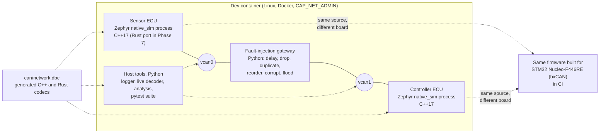

# Design notes

Every major decision in this project, the alternatives that were considered, and
the reason the alternative lost. Written so each section can be repeated in an
interview without the code in front of you. Sections are added phase by phase;
the phase that introduced a decision is noted where it matters.

Contents

0. [Goals and non-goals](#0-goals-and-non-goals)
1. [System architecture](#1-system-architecture)
2. [Repository layout](#2-repository-layout)
3. [Toolchain and pinned versions](#3-toolchain-and-pinned-versions)
4. [Why Zephyr rather than FreeRTOS](#4-why-zephyr-rather-than-freertos)
5. [Why native_sim plus SocketCAN, and why also a real STM32 target](#5-why-native_sim-plus-socketcan-and-why-also-a-real-stm32-target)
6. [Development environment: Docker, capabilities and vcan on WSL2](#6-development-environment-docker-capabilities-and-vcan-on-wsl2)
7. [Build system: freestanding Zephyr application and west manifest](#7-build-system-freestanding-zephyr-application-and-west-manifest)
8. [Continuous integration strategy](#8-continuous-integration-strategy)
9. [Phase plan and exit criteria](#9-phase-plan-and-exit-criteria)

---

## 0. Goals and non-goals

**Goal.** A two-node CAN network, each node a Zephyr RTOS application written in
C++17, exercised by a software fault-injection layer and an automated pytest
suite, with one node later re-implemented in Rust as a cross-language conformance
check. The point is to show the engineering habits a firmware team expects:
message definitions with counters and CRCs, explicit thread priorities, bounded
queues, a supervisor with timeouts, a CAN error-state machine with bus-off
recovery, no heap after boot, a watchdog, a shell for diagnostics, and tests
that print measured numbers.

**Non-goals.**

- No physical hardware. The STM32 build exists to prove the code is real embedded
  code (it links against a Cortex-M4 toolchain and an on-chip CAN driver), not to
  be flashed and measured here.
- No claim of real-time numbers. Everything timed in this repository runs on a
  simulated bus on a desktop operating system; every reported number is labelled
  that way.
- No AUTOSAR. The message protection scheme is modelled on the ideas behind
  AUTOSAR E2E profiles (alive counter plus CRC), but nothing here is an AUTOSAR
  implementation.

## 1. System architecture

The target architecture at the end of Phase 8. Phase 0 delivers the dev
container, one firmware process and the CI job.



Two topologies are used:

- **Plain bus.** Both ECU processes open `vcan0`. Used for timing measurements
  and most tests. Linux delivers every frame written to a vcan interface to every
  other socket on that interface, which is what a CAN bus does.
- **Gateway bus.** The sensor sits on `vcan0`, the controller on `vcan1`, and the
  Python gateway forwards frames between them while applying a fault model. The
  same firmware binary is used; the interface is chosen per process at run time
  (`--can-if=vcan1`).

The firmware is one codebase. The ECU role (sensor or controller) is a build-time
Kconfig choice from Phase 2 on, which keeps the protocol, supervisor and error
handling code shared and tested once.

## 2. Repository layout

Target layout at Phase 8. After Phase 0 the repository contains `.devcontainer/`,
`.github/`, `firmware/`, `tools/` and `docs/`; the other directories appear with
the phase that introduces them.

```
can-ecu-sim/
├── .devcontainer/        Dockerfile + devcontainer.json: the single toolchain image
├── .github/workflows/    CI (builds, unit tests, pytest on vcan, static analysis)
├── can/                  network.dbc, the one source of truth for every message
├── firmware/             Zephyr application (C++17)
│   ├── west.yml          pins the Zephyr revision and the modules it needs
│   └── app/              CMake project: src/, boards/ overlays, prj.conf
├── gateway/              Python fault-injection gateway between vcan0 and vcan1
├── host/                 Python host tools: logger, live decoder, analysis
├── tests/                pytest suite that drives the whole network
├── rust/                 no_std protocol crate + std adapter (sensor ECU port)
├── tools/                dev-container wrappers, vcan setup, smoke test
│   └── wsl2/             builds/installs the vcan module for Docker Desktop on Windows
├── docs/                 fault model mapping, phase logs, toolchain versions
├── DESIGN.md             this file
├── RESULTS.md            raw data behind every number in the README
└── README.md             overview, setup, results table
```

The layout separates "things that define the network" (`can/`), "things that run
on an ECU" (`firmware/`, `rust/`) and "things that observe or disturb the
network" (`gateway/`, `host/`, `tests/`). The DBC is upstream of all three.

## 3. Toolchain and pinned versions

Every tool lives in one Docker image so a build on Windows, Linux or CI is the
same build (macOS is untested, see §6). Versions are pinned where it matters for
reproducibility.

| Component | Version | Why this one |
|---|---|---|
| Base image | Ubuntu 24.04 | current LTS; ships CMake 3.28, Python 3.12, GCC 13, clang-tidy 18 |
| Zephyr RTOS | v4.3.1 (`firmware/west.yml`) | recent stable release line whose `SDK_VERSION` file asks for SDK 0.17.4; the newer 4.4.x line moved to the 1.0 SDK series, which was avoided to stay on a well-trodden toolchain |
| Zephyr SDK | 0.17.4, `arm-zephyr-eabi` only | the only cross toolchain this project needs (Cortex-M4F); the minimal bundle keeps the image smaller |
| Host compiler | Ubuntu GCC 13 with multilib | `native_sim` is a 32-bit build by default, so the simulated firmware keeps the 32-bit `int`/pointer model of the Cortex-M target |
| Rust | 1.89.0 + `thumbv7em-none-eabihf` | pinned stable; the target triple matches the F446's Cortex-M4F with hardware FPU |
| CAN tooling | can-utils (`candump`, `cansend`, `cangen`, `cangw`), python-can 4.x, cantools 40.x | the standard SocketCAN toolset; cantools reads the DBC and generates codecs |
| Test and analysis | pytest 8, gcovr, lcov, clang-tidy, cppcheck | used from Phase 5 and 6 on |

The exact versions present in the built image are printed by
`tools/dev.sh tools/print-versions.sh`; the output for the image used in the
results is kept in `docs/toolchain-versions.txt`.

## 4. Why Zephyr rather than FreeRTOS

Both are credible choices for a two-ECU demo; the decision is about what the
project needs to show and how much infrastructure it wants to write itself.

**What FreeRTOS gives you.** A scheduler, tasks, queues, semaphores, software
timers, stream buffers, and optional static allocation
(`configSUPPORT_STATIC_ALLOCATION`). It is small (a few kilobytes), simple to read
in full, MIT licensed, and extremely common in automotive-adjacent and consumer
products. Everything else is yours or the silicon vendor's: the CAN driver
(STM32Cube HAL), logging, a shell, a watchdog API and the build system. FreeRTOS
does have official POSIX and Windows simulator ports, but no driver model behind
them, so putting the same application on a desktop bus means writing a SocketCAN
shim that the real board never executes.

**What Zephyr gives you.** The same kernel primitives (threads, message queues,
semaphores, timers, work queues), plus a device driver model with a stable CAN API
(`can_send`, `can_add_rx_filter_msgq`, `can_get_state`,
`can_set_state_change_callback`, `can_recover`), devicetree and Kconfig for
configuration, a logging subsystem, an interactive shell, a watchdog API, a
`native_sim` board that runs the application as a Linux process, and a driver
that connects that process to a Linux SocketCAN interface. It is Apache-2.0,
governed by the Linux Foundation, and has an active functional-safety effort.

**Why Zephyr wins for this project.**

1. *One codebase, two targets, through the same driver API.* The sensor and
   controller firmware call the Zephyr CAN API; on `native_sim` that is backed by
   SocketCAN, on the Nucleo it is backed by the bxCAN driver. With FreeRTOS the
   simulator and the board would need two different CAN back ends written by me,
   and the test suite would be testing my shim as much as my firmware.
2. *The CAN error-state machine is already modelled.* Zephyr tracks the
   controller state (error-active, error-passive, bus-off), exposes TX/RX error
   counters through `can_get_state()` and state-change callbacks, and, with
   `CONFIG_CAN_MANUAL_RECOVERY_MODE=y` and the controller in
   `CAN_MODE_MANUAL_RECOVERY`, hands bus-off recovery to the application through
   `can_recover()`. Without that, bxCAN recovers automatically (its ABOM bit)
   behind the firmware's back. The firmware's job is the policy on top (backoff,
   safe state), which is the interesting part to show. The SocketCAN back end
   reports a constant error-active state, so on `native_sim` that state machine
   is driven through the Phase 3 test hook.
3. *Static allocation is the idiom, not an option.* `K_THREAD_DEFINE`,
   `K_MSGQ_DEFINE`, `K_SEM_DEFINE` are placed at link time. With
   `CONFIG_HEAP_MEM_POOL_SIZE=0` the kernel does not even compile `k_malloc`, so
   a stray call is a link error. The C/C++ runtime heap is closed separately:
   `CONFIG_COMMON_LIBC_MALLOC_ARENA_SIZE=0` removes picolibc's arena on the
   Nucleo (otherwise it would claim all remaining SRAM at boot), and Phase 2
   adds the proof, an `nm` check that the final ELF references none of
   `malloc`, `calloc`, `realloc` or `operator new`.
4. *Testing infrastructure.* `ztest` and `twister` run unit tests on `native_sim`
   with coverage, which Phase 5 needs.

**What it costs.**

- A steeper learning curve: devicetree overlays, Kconfig, CMake and west on top
  of the kernel. A FreeRTOS project is a handful of files.
- A heavier toolchain. The SDK plus a west workspace is gigabytes; FreeRTOS is a
  directory you vendor in. The Docker image absorbs this cost once.
- Footprint. A Zephyr image with logging and shell is tens of kilobytes larger
  than a FreeRTOS kernel; irrelevant on an F446 (512 KB flash) but real on a
  smaller part.
- API movement between releases. Pinning Zephyr in `west.yml` is mandatory.

**Honest framing for an interview.** Production automotive ECUs mostly run
AUTOSAR Classic (an OSEK-derived OS) or a vendor RTOS; FreeRTOS is common in
less safety-critical and aftermarket products; Zephyr is growing in robotics,
drones and industrial sensing. Zephyr was chosen here because it lets the same
application run on a desktop simulator and on an MCU through one driver API, which
is what makes an automated, hardware-free test suite meaningful. Every concept
transfers one-to-one: `k_thread` ↔ `xTaskCreate`, `k_msgq` ↔ `xQueue`,
`k_sem` ↔ `xSemaphore`, `k_timer` ↔ `xTimer`, `k_work` ↔ deferred work on the
timer task, ISR-to-thread handoff via a queue in both.

## 5. Why native_sim plus SocketCAN, and why also a real STM32 target

`native_sim` compiles the Zephyr kernel and the application into an ordinary
Linux executable. Zephyr threads are scheduled by Zephyr's own scheduler inside
that process on a *simulated* clock: code executes in zero simulated time, and
time advances only when the kernel idles until its next timer event. With
`CONFIG_NATIVE_SIM_SLOWDOWN_TO_REAL_TIME` (the default outside test builds) the
process additionally sleeps so that each simulated tick is released no earlier
than the matching wall-clock instant; if the host is late, the simulation simply
catches up. Two consequences shape the measurements in later phases: timestamps
taken inside the firmware (`k_uptime_get()`, log timestamps) are deterministic
and cannot show host jitter, while timestamps taken on the host side
(`candump -t`, python-can) include the process scheduling noise of a desktop OS.
Period and jitter are therefore always measured from the host side and labelled
as such. The `zephyr,native-linux-can` driver opens an `AF_CAN` raw socket on a
named host interface and moves frames between it and the Zephyr CAN API.

What this buys:

- Both ECUs, the gateway, `candump` and pytest are plain processes on one
  machine. Starting, stopping and inspecting them is trivial.
- Linux vcan has true bus semantics for delivery (every frame reaches every
  listener) and SocketCAN carries real `struct can_frame`s, so python-can,
  cantools and can-utils interoperate with the firmware unchanged.

What it cannot show, which is why the fault-injection layer exists (Phase 3):

- No arbitration, no bit timing, no electrical errors, no error frames. A vcan
  interface never reports a bus-off; the controller error state must be driven
  through a test-only hook in the firmware's hardware abstraction layer.
- Host timing. Frame delivery latency on vcan is microseconds of kernel work plus
  process scheduling on a desktop OS; measured jitter says something about the
  firmware's scheduling under Linux, not about a real bus.

The **Nucleo-F446RE** build exists so that the firmware is demonstrably embedded
code: it compiles with `arm-zephyr-eabi-gcc` for a Cortex-M4F and links a real
bxCAN driver (`st,stm32-bxcan`; the board's `can2` on PB12/PB13 is already the
chosen CAN bus in the upstream board file). From Phase 2 it enables the
independent watchdog with an `&iwdg { status = "okay"; }` overlay and
`CONFIG_WATCHDOG=y`; IWDG is clocked by the LSI oscillator and cannot be stopped
once started, which is the property the supervisor relies on. On `native_sim`
the identical `wdt_setup()`/`wdt_feed()` calls are served by a
`zephyr,counter-watchdog` node layered over the board's
`zephyr,native-sim-counter`, so the supervisor has one watchdog code path on both
targets. CI builds the Nucleo image on every push to `main` and on every pull
request. It is not run.

## 6. Development environment: Docker, capabilities and vcan on WSL2

**Decision: one Dockerfile, used three ways.** VS Code opens it as a dev
container (`.devcontainer/devcontainer.json`), `tools/dev.sh` / `tools/dev.ps1`
run one-off commands in it from any host shell, and CI builds the same Dockerfile
and runs every step through `tools/dev.sh`. There is no "works on my machine"
path that differs from CI.

**Capabilities.** Creating a network interface needs `CAP_NET_ADMIN`, so the
container runs with `--cap-add=NET_ADMIN` and nothing more. Opening a CAN raw
socket needs no capability, so locally and in the dev container the firmware
processes run as the unprivileged `dev` user; CI runs the same container as root
(`--user root`) only because the GitHub runner's checkout is owned by a different
uid. The container is never `--privileged`.

**vcan on Docker Desktop for Windows.** Containers share the kernel of the Docker
Desktop virtual machine, which on this host is Microsoft's WSL2 kernel. That
kernel ships the CAN core (`can`, `can-raw`, `can-bcm`, `can-gw`, `can-dev`) as
loadable modules but is built with `CONFIG_CAN_VCAN` disabled, so
`ip link add type vcan` fails with "Unknown device type". The options were:

| Option | Verdict |
|---|---|
| Replace the WSL2 kernel with a custom build (`.wslconfig` `kernel=`) | works, but a long full-kernel build, a machine-wide change, and a kernel that no longer receives Microsoft's updates |
| Emulate the bus in user space (UDP, Unix sockets) instead of vcan | loses the real SocketCAN path and with it can-utils and python-can interoperability, which is the point of the setup |
| Build only `vcan.ko` out of tree against the exact kernel source and config, install it into the VM's module directory | chosen: a few minutes, no kernel replacement, reversible, and the module is then auto-loaded on demand by `ip link add` like on any Linux box |

`tools/wsl2/install-vcan-module.sh` (or `.ps1`) implements the chosen option:
it reads the VM kernel release from `docker info`, downloads the matching
`linux-msft-wsl-<version>` source tag, applies the running kernel's
`/proc/config.gz` with `CONFIG_CAN_VCAN=m`, runs `modules_prepare` and builds
`drivers/net/can`, then copies `vcan.ko` into `/lib/modules/<release>/` of the VM
through a privileged helper container and runs `depmod`. The module directory is
an overlay whose writable layer lives in RAM (`df` reports a filesystem sized at
half of the VM's memory with no backing device), so the installed module is lost
whenever the VM reboots. Measured: `docker desktop stop` / `start` kept the VM
and the module (VM uptime continued), while `wsl --shutdown` rebooted the VM and
the module was gone. The build output is cached under
`tools/wsl2/out/<kernel-release>/`, so reinstalling is a ten-second copy,
`depmod` and `modprobe`, and `tools/dev.sh` / `tools/dev.ps1` do it automatically
when they find the module missing. A WSL kernel update changes the release
string and forces a rebuild. Module signing is disabled in that kernel. Because Microsoft
publishes neither `Module.symvers` nor CRC symbols for it, the module records
CRCs only for the symbols it imports from `can-dev` (built next to it from the
same source) and the loader accepts the rest with a one-time "no symbol version"
warning; ABI compatibility comes from building from the identical source tag and
configuration, and `vermagic` is still checked.

On native Linux and on GitHub-hosted runners none of this is needed:
`sudo modprobe vcan` on the host is enough, and the container creates interfaces
in its own network namespace. Docker Desktop for macOS runs a LinuxKit kernel
that this project has not examined: the image and both firmware targets build
there (under amd64 emulation on Apple silicon), but the simulated bus is
unverified, so macOS is not listed as a supported host.

## 7. Build system: freestanding Zephyr application and west manifest

The image contains a west workspace at `/opt/zephyrproject`, initialised from the
repository's own `firmware/west.yml` at image build time. The firmware is built as
a Zephyr *freestanding application*: `ZEPHYR_BASE` points into that workspace and
the application directory can live anywhere, including a bind-mounted checkout at
any path. This avoids the usual dev-container problem where `west update` has to
clone gigabytes next to the repository after every container (re)creation, and it
keeps CI and local builds identical.

The trade-off: because the manifest is copied into the image, a change to
`firmware/west.yml` takes effect only after `tools/dev.sh --build`. To make that
mistake loud rather than silent, `firmware/app/CMakeLists.txt` compares the
repository's `west.yml` with the copy baked into the image and fails the
configure step with "rebuild the image" if they differ.

`west.yml` allowlists only `cmsis_6` (the CMSIS 6 core headers Zephyr 4.x uses
for Cortex-M; the older `cmsis` module serves Cortex-A/R) and `hal_stm32`, so the
workspace holds exactly what the two boards need. Zephyr is cloned shallow
(`--narrow -o=--depth=1`) and the STM32 HAL is pruned to the F4 family.

## 8. Continuous integration strategy

A single GitHub Actions job builds the dev image (layer cache in GitHub's cache,
image pushed to GHCR on `main` so it can also be pulled instead of built), then
runs every step through `tools/dev.sh`, the same wrapper used locally. The
runner's own kernel supplies `vcan`; the container is started with
`CAP_NET_ADMIN` only. Phase 0 runs three steps: build for `native_sim`, build for
`nucleo_f446re`, and a smoke test that starts the simulated firmware on `vcan0`
and asserts with `candump` that frames with the expected identifier appear. Later
phases add unit tests with coverage, the full pytest suite, static analysis and
report artifacts to the same job graph.

## 9. Phase plan and exit criteria

| Phase | Deliverable | Exit criterion |
|---|---|---|
| 0 | dev container, vcan tooling, minimal firmware, CI | `candump` shows the frame from a `native_sim` process; the same app builds for `nucleo_f446re`; CI green |
| 1 | `can/network.dbc`, codec generator, host unit tests | every message round-trips through pack/unpack; counter and CRC8 verified against an independent reference |
| 2 | full firmware, both roles | shell shows status; controller enters safe state on heartbeat loss; no heap after init proven |
| 3 | fault gateway and HAL error hook | each fault type demonstrated and mapped to real-bus behaviour in `docs/` |
| 4 | logger, live decoder, analysis | bus load, period/jitter and echo RTT percentiles reported from a recorded run |
| 5 | pytest suite, C++ unit tests, coverage | the seven test groups pass and print measured values; coverage reported |
| 6 | CI complete | both targets built, all tests run, clang-tidy/cppcheck clean, artifacts uploaded |
| 7 | Rust sensor ECU | passes the unchanged pytest suite against the C++ controller; `no_std` crate cross-compiles |
| 8 | README, DESIGN, RESULTS | every number in the README traceable to a command and a raw log |
