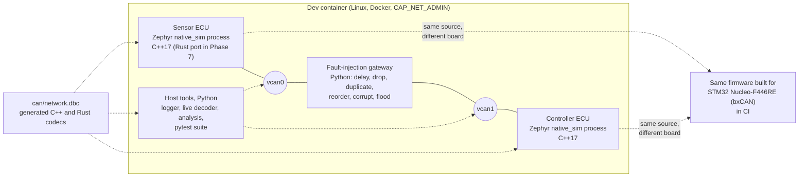

# Design notes

Every major decision in this project, the alternatives that were considered, and
the reason the alternative lost. Written so each section can be repeated in an
interview without the code in front of you. Sections are added phase by phase;
the phase that introduced a decision is noted where it matters.

Contents

0. [Goals and non-goals](#0-goals-and-non-goals)
1. [System architecture](#1-system-architecture)
2. [Repository layout](#2-repository-layout)
3. [Toolchain and pinned versions](#3-toolchain-and-pinned-versions)
4. [Why Zephyr rather than FreeRTOS](#4-why-zephyr-rather-than-freertos)
5. [Why native_sim plus SocketCAN, and why also a real STM32 target](#5-why-native_sim-plus-socketcan-and-why-also-a-real-stm32-target)
6. [Development environment: Docker, capabilities and vcan on WSL2](#6-development-environment-docker-capabilities-and-vcan-on-wsl2)
7. [Build system: freestanding Zephyr application and west manifest](#7-build-system-freestanding-zephyr-application-and-west-manifest)
8. [Continuous integration strategy](#8-continuous-integration-strategy)
9. [Phase plan and exit criteria](#9-phase-plan-and-exit-criteria)
10. [Phase 1: network definition, protection scheme and generated codec](#10-phase-1-network-definition-protection-scheme-and-generated-codec)
11. [Phase 2: the firmware](#11-phase-2-the-firmware)

---

## 0. Goals and non-goals

**Goal.** A two-node CAN network, each node a Zephyr RTOS application written in
C++17, exercised by a software fault-injection layer and an automated pytest
suite, with one node later re-implemented in Rust as a cross-language conformance
check. The point is to show the engineering habits a firmware team expects:
message definitions with counters and CRCs, explicit thread priorities, bounded
queues, a supervisor with timeouts, a CAN error-state machine with bus-off
recovery, no heap after boot, a watchdog, a shell for diagnostics, and tests
that print measured numbers.

**Non-goals.**

- No physical hardware. The STM32 build exists to prove the code is real embedded
  code (it links against a Cortex-M4 toolchain and an on-chip CAN driver), not to
  be flashed and measured here.
- No claim of real-time numbers. Everything timed in this repository runs on a
  simulated bus on a desktop operating system; every reported number is labelled
  that way.
- No AUTOSAR. The message protection scheme is modelled on the ideas behind
  AUTOSAR E2E profiles (alive counter plus CRC), but nothing here is an AUTOSAR
  implementation.

## 1. System architecture

The target architecture at the end of Phase 8. Phase 0 delivers the dev
container, one firmware process and the CI job.



Two topologies are used:

- **Plain bus.** Both ECU processes open `vcan0`. Used for timing measurements
  and most tests. Linux delivers every frame written to a vcan interface to every
  other socket on that interface, which is what a CAN bus does.
- **Gateway bus.** The sensor sits on `vcan0`, the controller on `vcan1`, and the
  Python gateway forwards frames between them while applying a fault model. The
  same firmware binary is used; the interface is chosen per process at run time
  (`--can-if=vcan1`).

The firmware is one codebase. The ECU role (sensor or controller) is a build-time
Kconfig choice from Phase 2 on, which keeps the protocol, supervisor and error
handling code shared and tested once.

## 2. Repository layout

Target layout at Phase 8. After Phase 2 the repository contains `.devcontainer/`,
`.github/`, `can/`, `firmware/`, `tools/` and `docs/`; the other directories
appear with the phase that introduces them.

```
can-ecu-sim/
├── .devcontainer/        Dockerfile + devcontainer.json: the single toolchain image
├── .github/workflows/    CI (builds, unit tests, pytest on vcan, static analysis)
├── can/                  network.dbc (the one source of truth), codec generator,
│                         Python reference implementation of the protection scheme
├── firmware/             Zephyr application (C++17)
│   ├── west.yml          pins the Zephyr revision and the modules it needs
│   ├── app/              Kconfig (role, timeouts, recovery policy), boards/ overlays
│   │   └── src/          main, app/ (threads, supervisor, roles, test hooks),
│   │                     hal/ (CAN controller, watchdog), shell_cmds.c, alloc_guard.c
│   └── lib/              header-only libraries, unit tested on the host
│       ├── protocol/     generated codec, CRC-8, E2E counter/CRC
│       └── ecu_core/     timeout monitor, protected RX policy, CAN error state
│                         machine, node state machine, liveness, error-counter model
├── gateway/              Python fault-injection gateway between vcan0 and vcan1
├── host/                 Python host tools: logger, live decoder, analysis
├── tests/                pytest suite that drives the whole network
├── rust/                 no_std protocol crate + std adapter (sensor ECU port)
├── tools/                dev-container wrappers, vcan setup, smoke test
│   └── wsl2/             builds/installs the vcan module for Docker Desktop on Windows
├── docs/                 fault model mapping, phase logs, toolchain versions
├── DESIGN.md             this file
├── RESULTS.md            raw data behind every number in the README
└── README.md             overview, setup, results table
```

The layout separates "things that define the network" (`can/`), "things that run
on an ECU" (`firmware/`, `rust/`) and "things that observe or disturb the
network" (`gateway/`, `host/`, `tests/`). The DBC is upstream of all three.

## 3. Toolchain and pinned versions

Every tool lives in one Docker image so a build on Windows, Linux or CI is the
same build (macOS is untested, see §6). Versions are pinned where it matters for
reproducibility.

| Component | Version | Why this one |
|---|---|---|
| Base image | Ubuntu 24.04 | current LTS; ships CMake 3.28, Python 3.12, GCC 13, clang-tidy 18 |
| Zephyr RTOS | v4.3.1 (`firmware/west.yml`) | recent stable release line whose `SDK_VERSION` file asks for SDK 0.17.4; the newer 4.4.x line moved to the 1.0 SDK series, which was avoided to stay on a well-trodden toolchain |
| Zephyr SDK | 0.17.4, `arm-zephyr-eabi` only | the only cross toolchain this project needs (Cortex-M4F); the minimal bundle keeps the image smaller |
| Host compiler | Ubuntu GCC 13 with multilib | `native_sim` is a 32-bit build by default, so the simulated firmware keeps the 32-bit `int`/pointer model of the Cortex-M target |
| Rust | 1.89.0 + `thumbv7em-none-eabihf` | pinned stable; the target triple matches the F446's Cortex-M4F with hardware FPU |
| CAN tooling | can-utils (`candump`, `cansend`, `cangen`, `cangw`), python-can 4.x, cantools 40.x | the standard SocketCAN toolset; cantools parses the DBC for `can/gen_codec.py` and is the encode/decode oracle for the generated test vectors |
| Test and analysis | GoogleTest (Ubuntu `libgtest-dev`), pytest 8, gcovr 8 (from Phase 1); lcov, clang-tidy 18, cppcheck 2.13 (Phase 6) | host unit tests of OS-free code with coverage; static analysis later |

The exact versions present in the built image are printed by
`tools/dev.sh tools/print-versions.sh`; the output for the image used in the
results is kept in `docs/toolchain-versions.txt`.

## 4. Why Zephyr rather than FreeRTOS

Both are credible choices for a two-ECU demo; the decision is about what the
project needs to show and how much infrastructure it wants to write itself.

**What FreeRTOS gives you.** A scheduler, tasks, queues, semaphores, software
timers, stream buffers, and optional static allocation
(`configSUPPORT_STATIC_ALLOCATION`). It is small (a few kilobytes), simple to read
in full, MIT licensed, and extremely common in automotive-adjacent and consumer
products. Everything else is yours or the silicon vendor's: the CAN driver
(STM32Cube HAL), logging, a shell, a watchdog API and the build system. FreeRTOS
does have official POSIX and Windows simulator ports, but no driver model behind
them, so putting the same application on a desktop bus means writing a SocketCAN
shim that the real board never executes.

**What Zephyr gives you.** The same kernel primitives (threads, message queues,
semaphores, timers, work queues), plus a device driver model with a stable CAN API
(`can_send`, `can_add_rx_filter_msgq`, `can_get_state`,
`can_set_state_change_callback`, `can_recover`), devicetree and Kconfig for
configuration, a logging subsystem, an interactive shell, a watchdog API, a
`native_sim` board that runs the application as a Linux process, and a driver
that connects that process to a Linux SocketCAN interface. It is Apache-2.0,
governed by the Linux Foundation, and has an active functional-safety effort.

**Why Zephyr wins for this project.**

1. *One codebase, two targets, through the same driver API.* The sensor and
   controller firmware call the Zephyr CAN API; on `native_sim` that is backed by
   SocketCAN, on the Nucleo it is backed by the bxCAN driver. With FreeRTOS the
   simulator and the board would need two different CAN back ends written by me,
   and the test suite would be testing my shim as much as my firmware.
2. *The CAN error-state machine is already modelled.* Zephyr tracks the
   controller state (error-active, error-passive, bus-off), exposes TX/RX error
   counters through `can_get_state()` and state-change callbacks, and, with
   `CONFIG_CAN_MANUAL_RECOVERY_MODE=y` and the controller in
   `CAN_MODE_MANUAL_RECOVERY`, hands bus-off recovery to the application through
   `can_recover()`. Without that, bxCAN recovers automatically (its ABOM bit)
   behind the firmware's back. The firmware's job is the policy on top (backoff,
   safe state), which is the interesting part to show. The SocketCAN back end
   reports a constant error-active state, so on `native_sim` that state machine
   is driven through the Phase 3 test hook.
3. *Static allocation is the idiom, not an option.* `K_THREAD_DEFINE`,
   `K_MSGQ_DEFINE`, `K_SEM_DEFINE` are placed at link time. With
   `CONFIG_HEAP_MEM_POOL_SIZE=0` the kernel does not even compile `k_malloc`, so
   a stray call is a link error. The C/C++ runtime heap is closed separately:
   `CONFIG_COMMON_LIBC_MALLOC_ARENA_SIZE=0` removes picolibc's arena on the
   Nucleo (otherwise it would claim all remaining SRAM at boot), and Phase 2
   adds the proof, an `nm` check that the final ELF references none of
   `malloc`, `calloc`, `realloc` or `operator new`.
4. *Testing infrastructure.* `ztest` and `twister` run unit tests on `native_sim`
   with coverage, which Phase 5 needs for the kernel-dependent code (supervisor,
   queues, CAN state machine). OS-free code such as the protocol library is
   tested on the host with GoogleTest instead (Phase 1, see §10.4).

**What it costs.**

- A steeper learning curve: devicetree overlays, Kconfig, CMake and west on top
  of the kernel. A FreeRTOS project is a handful of files.
- A heavier toolchain. The SDK plus a west workspace is gigabytes; FreeRTOS is a
  directory you vendor in. The Docker image absorbs this cost once.
- Footprint. A Zephyr image with logging and shell is tens of kilobytes larger
  than a FreeRTOS kernel; irrelevant on an F446 (512 KB flash) but real on a
  smaller part.
- API movement between releases. Pinning Zephyr in `west.yml` is mandatory.

**Honest framing for an interview.** Production automotive ECUs mostly run
AUTOSAR Classic (an OSEK-derived OS) or a vendor RTOS; FreeRTOS is common in
less safety-critical and aftermarket products; Zephyr is growing in robotics,
drones and industrial sensing. Zephyr was chosen here because it lets the same
application run on a desktop simulator and on an MCU through one driver API, which
is what makes an automated, hardware-free test suite meaningful. Every concept
transfers one-to-one: `k_thread` ↔ `xTaskCreate`, `k_msgq` ↔ `xQueue`,
`k_sem` ↔ `xSemaphore`, `k_timer` ↔ `xTimer`, `k_work` ↔ deferred work on the
timer task, ISR-to-thread handoff via a queue in both.

## 5. Why native_sim plus SocketCAN, and why also a real STM32 target

`native_sim` compiles the Zephyr kernel and the application into an ordinary
Linux executable. Zephyr threads are scheduled by Zephyr's own scheduler inside
that process on a *simulated* clock: code executes in zero simulated time, and
time advances only when the kernel idles until its next timer event. With
`CONFIG_NATIVE_SIM_SLOWDOWN_TO_REAL_TIME` (the default outside test builds) the
process additionally sleeps so that each simulated tick is released no earlier
than the matching wall-clock instant; if the host is late, the simulation simply
catches up. Two consequences shape the measurements in later phases: timestamps
taken inside the firmware (`k_uptime_get()`, log timestamps) are deterministic
and cannot show host jitter, while timestamps taken on the host side
(`candump -t`, python-can) include the process scheduling noise of a desktop OS.
Period and jitter are therefore always measured from the host side and labelled
as such. The `zephyr,native-linux-can` driver opens an `AF_CAN` raw socket on a
named host interface and moves frames between it and the Zephyr CAN API.

What this buys:

- Both ECUs, the gateway, `candump` and pytest are plain processes on one
  machine. Starting, stopping and inspecting them is trivial.
- Linux vcan has true bus semantics for delivery (every frame reaches every
  listener) and SocketCAN carries real `struct can_frame`s, so python-can,
  cantools and can-utils interoperate with the firmware unchanged.

What it cannot show, which is why the fault-injection layer exists (Phase 3):

- No arbitration, no bit timing, no electrical errors, no error frames. A vcan
  interface never reports a bus-off; the controller error state must be driven
  through a test-only hook in the firmware's hardware abstraction layer.
- Host timing. Frame delivery latency on vcan is microseconds of kernel work plus
  process scheduling on a desktop OS; measured jitter says something about the
  firmware's scheduling under Linux, not about a real bus.

The **Nucleo-F446RE** build exists so that the firmware is demonstrably embedded
code: it compiles with `arm-zephyr-eabi-gcc` for a Cortex-M4F and links a real
bxCAN driver (`st,stm32-bxcan`; the board's `can2` on PB12/PB13 is already the
chosen CAN bus in the upstream board file). From Phase 2 it enables the
independent watchdog with an `&iwdg { status = "okay"; }` overlay and
`CONFIG_WATCHDOG=y`; IWDG is clocked by the LSI oscillator and cannot be stopped
once started, which is the property the supervisor relies on. On `native_sim`
the identical `wdt_setup()`/`wdt_feed()` calls are served by a
`zephyr,counter-watchdog` node layered over the board's
`zephyr,native-sim-counter`, so the supervisor has one watchdog code path on both
targets. CI builds the Nucleo image on every push to `main` and on every pull
request. It is not run.

## 6. Development environment: Docker, capabilities and vcan on WSL2

**Decision: one Dockerfile, used three ways.** VS Code opens it as a dev
container (`.devcontainer/devcontainer.json`), `tools/dev.sh` / `tools/dev.ps1`
run one-off commands in it from any host shell, and CI builds the same Dockerfile
and runs every step through `tools/dev.sh`. There is no "works on my machine"
path that differs from CI.

**Capabilities.** Creating a network interface needs `CAP_NET_ADMIN`, so the
container runs with `--cap-add=NET_ADMIN` and nothing more. Opening a CAN raw
socket needs no capability, so locally and in the dev container the firmware
processes run as the unprivileged `dev` user; CI runs the same container as root
(`--user root`) only because the GitHub runner's checkout is owned by a different
uid. The container is never `--privileged`.

**vcan on Docker Desktop for Windows.** Containers share the kernel of the Docker
Desktop virtual machine, which on this host is Microsoft's WSL2 kernel. That
kernel ships the CAN core (`can`, `can-raw`, `can-bcm`, `can-gw`, `can-dev`) as
loadable modules but is built with `CONFIG_CAN_VCAN` disabled, so
`ip link add type vcan` fails with "Unknown device type". The options were:

| Option | Verdict |
|---|---|
| Replace the WSL2 kernel with a custom build (`.wslconfig` `kernel=`) | works, but a long full-kernel build, a machine-wide change, and a kernel that no longer receives Microsoft's updates |
| Emulate the bus in user space (UDP, Unix sockets) instead of vcan | loses the real SocketCAN path and with it can-utils and python-can interoperability, which is the point of the setup |
| Build only `vcan.ko` out of tree against the exact kernel source and config, install it into the VM's module directory | chosen: a few minutes, no kernel replacement, reversible, and the module is then auto-loaded on demand by `ip link add` like on any Linux box |

`tools/wsl2/install-vcan-module.sh` (or `.ps1`) implements the chosen option:
it reads the VM kernel release from `docker info`, downloads the matching
`linux-msft-wsl-<version>` source tag, applies the running kernel's
`/proc/config.gz` with `CONFIG_CAN_VCAN=m`, runs `modules_prepare` and builds
`drivers/net/can`, then copies `vcan.ko` into `/lib/modules/<release>/` of the VM
through a privileged helper container and runs `depmod`. The module directory is
an overlay whose writable layer lives in RAM (`df` reports a filesystem sized at
half of the VM's memory with no backing device), so the installed module is lost
whenever the VM reboots. Measured: `docker desktop stop` / `start` kept the VM
and the module (VM uptime continued), while `wsl --shutdown` rebooted the VM and
the module was gone. The build output is cached under
`tools/wsl2/out/<kernel-release>/`, so reinstalling is a ten-second copy,
`depmod` and `modprobe`, and `tools/dev.sh` / `tools/dev.ps1` do it automatically
when they find the module missing. A WSL kernel update changes the release
string and forces a rebuild. Module signing is disabled in that kernel. Because Microsoft
publishes neither `Module.symvers` nor CRC symbols for it, the module records
CRCs only for the symbols it imports from `can-dev` (built next to it from the
same source) and the loader accepts the rest with a one-time "no symbol version"
warning; ABI compatibility comes from building from the identical source tag and
configuration, and `vermagic` is still checked.

On native Linux and on GitHub-hosted runners none of this is needed:
`sudo modprobe vcan` on the host is enough, and the container creates interfaces
in its own network namespace. Docker Desktop for macOS runs a LinuxKit kernel
that this project has not examined: the image and both firmware targets build
there (under amd64 emulation on Apple silicon), but the simulated bus is
unverified, so macOS is not listed as a supported host.

## 7. Build system: freestanding Zephyr application and west manifest

The image contains a west workspace at `/opt/zephyrproject`, initialised from the
repository's own `firmware/west.yml` at image build time. The firmware is built as
a Zephyr *freestanding application*: `ZEPHYR_BASE` points into that workspace and
the application directory can live anywhere, including a bind-mounted checkout at
any path. This avoids the usual dev-container problem where `west update` has to
clone gigabytes next to the repository after every container (re)creation, and it
keeps CI and local builds identical.

The trade-off: because the manifest is copied into the image, a change to
`firmware/west.yml` takes effect only after `tools/dev.sh --build`. To make that
mistake loud rather than silent, `firmware/app/CMakeLists.txt` compares the
repository's `west.yml` with the copy baked into the image and fails the
configure step with "rebuild the image" if they differ.

`west.yml` allowlists only `cmsis_6` (the CMSIS 6 core headers Zephyr 4.x uses
for Cortex-M; the older `cmsis` module serves Cortex-A/R) and `hal_stm32`, so the
workspace holds exactly what the two boards need. Zephyr is cloned shallow
(`--narrow -o=--depth=1`) and the STM32 HAL is pruned to the F4 family.

## 8. Continuous integration strategy

A single GitHub Actions job builds the dev image (layer cache in GitHub's cache,
image pushed to GHCR on `main` so it can also be pulled instead of built), then
runs every step through `tools/dev.sh`, the same wrapper used locally. The
runner's own kernel supplies `vcan`; the container is started with
`CAP_NET_ADMIN` only. After Phase 2 the job runs, in order: a check that every
shell script is committed executable, the `vcan` precondition on the runner
(first, so a runner without the module fails in seconds), `tools/gen-all.sh
--check` (the committed headers match the DBC), the Python reference tests, the
GoogleTest host tests of both libraries with gcovr coverage (uploaded as the
`host-test-coverage` artifact), the four firmware images (two boards, two
roles), the allocator check on each image, the vcan smoke test whose captured
frames are verified by `can/verify_candump.py`, and the three network demos
(`run`, `safe-state`, `bus-off`) with their logs uploaded as `network-logs`. A
demo that fails a criterion while the bus log shows a host scheduling stall is
reported inconclusive and repeated up to twice; a failure without a stall is a
real failure. Phase 3 adds the gateway's fault-engine unit tests to the pytest
step and, after the demos, the fifteen fault-injection scenarios on the
two-segment topology (`tools/fault_scenarios.py`, section 12), judged and
retried by the same rules. Phase 4 adds the host tools' unit tests (on
python-can's in-process virtual interface) to the pytest step and, last, the
recorded run of the plain-bus network through the logger, the live decoder and
the echo probe with the analysis of the recording (`tools/record_and_analyze.py`,
section 13.5). Later phases add the pytest suite, static analysis and the Rust
build to the same job.

## 9. Phase plan and exit criteria

| Phase | Deliverable | Exit criterion |
|---|---|---|
| 0 | dev container, vcan tooling, minimal firmware, CI | `candump` shows the frame from a `native_sim` process; the same app builds for `nucleo_f446re`; CI green |
| 1 | `can/network.dbc`, codec generator, host unit tests | every message round-trips through pack/unpack; counter and CRC8 verified against an independent reference |
| 2 | full firmware, both roles | shell shows status; controller enters safe state on heartbeat loss; no heap after init proven |
| 3 | fault gateway and HAL error hook | each fault type demonstrated and mapped to real-bus behaviour in `docs/` |
| 4 | logger, live decoder, analysis | bus load, period/jitter and echo RTT percentiles reported from a recorded run |
| 5 | pytest suite, firmware unit tests (ztest on `native_sim`) for the supervisor and CAN state machine, firmware coverage | the seven test groups pass and print measured values; coverage reported (the protocol library's host tests are Phase 1) |
| 6 | CI complete | both targets built, all tests run, clang-tidy/cppcheck clean, artifacts uploaded |
| 7 | Rust sensor ECU | passes the unchanged pytest suite against the C++ controller; `no_std` crate cross-compiles |
| 8 | README, DESIGN, RESULTS | every number in the README traceable to a command and a raw log |

## 10. Phase 1: network definition, protection scheme and generated codec

### 10.1 The message set

`can/network.dbc` is the single source of truth: the firmware codec, the test
vectors, the host tools and the Rust port are all derived from it.

| ID | Message | Sender | Period | Protected | Purpose |
|---|---|---|---|---|---|
| 0x080 | `CONTROLLER_COMMAND` | controller | 20 ms | yes | torque and steering command, actuator enable, the controller's mode |
| 0x100 | `SENSOR_DATA` | sensor | 10 ms | yes | speed, yaw rate, longitudinal acceleration, sensor status |
| 0x110 | `BATTERY_STATUS` | sensor | 100 ms | yes | pack voltage and current, state of charge, temperature, flags |
| 0x200 | `SENSOR_HEARTBEAT` | sensor | 100 ms | yes | node state, uptime, CAN controller state, bus-off count, error flags |
| 0x201 | `CONTROLLER_HEARTBEAT` | controller | 100 ms | yes | same layout as the sensor heartbeat |
| 0x300 | `ECHO_REQUEST` | test host | event | no | round-trip probe addressed to one node or all |
| 0x301 | `SENSOR_ECHO_RESPONSE` | sensor | event | no | echo of seq and payload plus the ECU's own turnaround time |
| 0x302 | `CONTROLLER_ECHO_RESPONSE` | controller | event | no | same layout, the controller's answer |
| 0x7E0 | `TEST_CONTROL` | test host | event | no | fault-injection commands, accepted only by test builds with the magic 0xC0DE |

**Identifier choice.** On a real bus the lowest identifier wins arbitration, so
the actuator command gets the lowest ID, the 10 ms sensor sample the next, and
the test message the highest (0x7E0, in the range conventionally used for
diagnostics) so test traffic can never delay safety traffic. Every identifier
has exactly one transmitter: two nodes answering a broadcast echo under one
identifier would both win arbitration and destroy each other's frame in the
data field, so each ECU has its own echo response identifier (the first draft
shared one, which only works because vcan serialises writes). Standard 11-bit
identifiers are enough for nine messages and keep every frame short.

**Bus load.** The periodic messages add up to 180 frames per second. A standard
8-byte frame is at most 135 bits on the wire (111 bits plus up to 24 stuff bits,
including the interframe space), so the periodic load is about 24 kbit/s: 4.9 %
of a 500 kbit/s bus, 19 % of the 125 kbit/s default the Nucleo build uses. The
network is deliberately light so the fault-injection flood test (Phase 3) has
room to saturate it.

**What the heartbeats carry.** Besides "I am alive", each heartbeat publishes
the node's state machine state, its CAN controller state (error-active,
error-passive, bus-off, stopped), a bus-off counter and latched error flags.
That makes the internal state observable on the bus itself, which is how the
pytest suite later checks error-passive and bus-off transitions and safe-state
entry without a debugger.

**Little-endian signals.** All multi-byte signals are Intel byte order, matching
the Cortex-M4 and the x86 host, so no byte swapping is needed on either target
and the generated bit copying stays simple.

### 10.2 The protection scheme: rolling counter and CRC-8

Modelled on AUTOSAR E2E profile 1 (layout, identifier in the CRC, 4-bit
counter) and profile 2 (polynomial); not an implementation of either:

| Byte | Content |
|---|---|
| 0 | CRC-8H2F over the 16-bit big-endian identifier followed by bytes 1..7 |
| 1, bits 0-3 | 4-bit rolling counter, +1 per transmission, 15 wraps to 0 |
| 1, bits 4-7 and 2..7 | message payload |

Protected messages are always 8 bytes; the generator enforces it, so the CRC
always covers the same 72 bits and the receiver's DLC check is a single
comparison.

**Why cover the identifier.** CAN's own 15-bit CRC already protects the bits on
the wire; the link layer is not the threat this scheme addresses. The E2E layer
catches what happens before and after the wire: corrupted memory, a gateway
that forwards a frame under the wrong identifier, a stale copy replayed, frames
lost in a queue. Mixing the identifier into the CRC means a frame that is
intact but misrouted fails the check, and the unit tests prove it
(`E2e.MisroutedFrameIsRejected`). What the CRC cannot see is truncation: it is
computed over whatever arrived, so a frame shortened by trailing zero bytes can
still check out. That is why every receiver compares the DLC with the message
definition before it evaluates the CRC, and why `can/verify_candump.py` counts a
wrong DLC as a fault of its own.

**Why a 4-bit counter.** The receiver classifies each counter delta against the
last accepted counter: 0 is a repeated (stale or duplicated) frame, 1 is
correct, 2 to 8 means one to seven frames were lost, 9 to 15 is an
out-of-sequence frame (late or replayed). Correct, repeated and skipped frames
move the reference; an out-of-sequence frame does not, so a lone late frame
costs exactly one fault and the next good frame is accepted as "ok" rather
than being miscounted as seven lost frames. Four bits are enough because a gap
of more than seven 10 ms frames is a timeout the supervisor catches anyway
(Phase 2), and the nibble leaves the upper half of byte 1 for payload. E2E
profile 1 uses the same width. The limit of the scheme is the 16-frame window:
a frame delayed by exactly 16 periods looks like a repetition, one delayed by
17 looks correct; the supervisor's timeouts, not the counter, bound staleness.

**Why this polynomial.** Two CRC-8 polynomials are standard in AUTOSAR: 0x1D
(SAE J1850, used by E2E profile 1) and 0x2F (CRC8H2F, used by profile 2).
A CRC's error-detection strength depends on the length it protects, so instead
of quoting a table the choice was computed for this project's codeword, 72
protected data bits plus the 8 CRC bits (`python3 can/crc_hd.py`):

| Polynomial | undetected 2-bit errors | undetected 3-bit errors | undetected 4-bit errors | Hamming distance |
|---|---|---|---|---|
| 0x2F CRC8H2F | 0 of 3,160 | 0 of 82,160 | 12,629 of 1,581,580 | 4 |
| 0x1D SAE J1850 | 0 of 3,160 | 362 of 82,160 | 6,152 of 1,581,580 | 3 |

0x2F detects every single, double and triple bit error in our 80-bit codeword;
0x1D does not, so 0x2F it is. The structural reason: 0x2F has an even number
of terms, so the polynomial has the factor (x + 1), which guarantees detection
of every odd number of bit errors; 0x1D has an odd number of terms and no such
factor. Both implementations (C++ and Python) are checked against the seven
CRC8H2F check values published in the AUTOSAR CRC library specification and
against each other on random frames. An 8-bit CRC still lets one in 256
random multi-bit corruptions through; that residual risk is why the counter,
the timeouts and the plausibility checks of Phase 2 exist as well. The scheme
is not a security measure: anyone on the bus can compute it.

### 10.3 The generated codec

**Why a generator of our own.** cantools can emit C
(`cantools generate_c_source`): C structs with per-signal encode and decode
functions (`double` by default, `float` with `--use-float`), frame-ID, length,
extended-flag and cycle-time macros, and range checks. It does not give what
this firmware wants: C++ types (`enum class`, `std::array<uint8_t, DLC>`,
`constexpr` round trips usable in `static_assert`), the SafetyRelevant and
TestOnly attributes, a check that protected messages have `crc` at byte 0 and
`counter` at byte 1, or a per-field metadata table. The generator in
`can/gen_codec.py` is a few hundred lines: it uses cantools only as the DBC
*parser*, refuses anything it does not model (big-endian, multiplexed, float or
overlapping signals, extended identifiers, non-positive factors, enum values
that do not fit their signal, a safety-relevant message that is not 8 bytes or
lacks `crc` at byte 0 and `counter` at byte 1), and writes one header,
`firmware/lib/protocol/include/protocol/messages.hpp`.

**Shape of the generated code.** One struct per message with the *raw* integer
signal values exactly as they travel on the wire, `constexpr` metadata
(identifier, DLC, cycle time, safety-relevant and test-only flags, a per-field
table with bit positions, scale, offset and raw range), `to_frame()`,
`from_frame()` and `from_buffer(pointer, length, out)`, `operator==`, physical
accessors (`speed_phys()`, `set_speed_phys()`) only for scaled signals, and
`enum class` types with `to_string()` for signals that carry an `EnumName`
attribute in the DBC. Everything is `constexpr`, so a pack/unpack round trip
is checked with `static_assert` in the tests.

**Raw integers, not floats, on the wire path.** The receive path never touches
floating point: CRC and counter work on bytes, comparisons work on integers, and
the physical conversion is an explicit, separate step with rounding to the
nearest raw step and saturation at the DBC range. That keeps decoding
deterministic across the Cortex-M4 and the host, keeps `-Wconversion` clean,
and makes test vectors exact.

**Generated code is committed.** The repository builds without running the
generator, reviewers can read the codec, and CI runs `tools/gen-all.sh --check`
to fail the build if the DBC and the committed headers ever drift apart.

### 10.4 How the codec was proven correct

Three implementations are cross-checked. cantools is third-party and is the
oracle for bit layout and scaling. `can/e2e_ref.py` and the C++ CRC/E2E code
were both written by me from the same written specification (the DBC header
comment and the AUTOSAR CRC8H2F parameters), deliberately by different
methods: the Python CRC is bitwise, the C++ one is a compile-time table that
is itself checked against its own bitwise definition; the seven published
AUTOSAR check values anchor both to an external source.

1. **cantools** is the oracle for bit layout, sign handling and physical
   scaling. `can/gen_test_vectors.py` encodes 32 raw vectors per message with
   it (every signal at its minimum, at its maximum, and 30 seeded random
   vectors), decodes them scaled, and writes both to a header.
2. **`can/e2e_ref.py`** is the oracle for the CRC and the protected frames: 64
   random identifier-and-frame CRCs and 20 protected frames, plus the AUTOSAR
   check values.
3. **The C++ library** is the unit under test. The GoogleTests check that every
   vector decodes to the expected raw values and re-encodes to the identical
   bytes, that every physical accessor agrees with cantools and round-trips
   back to the same raw value, that setters saturate and handle NaN, that
   every single-bit error in the 56 covered payload bits and the 11 identifier
   bits of every protected vector is detected (exhaustive, 1,340 cases), that
   the counter policy behaves as specified including the late-frame case, that
   every raw value of every enum signal maps to its DBC label or to "UNKNOWN",
   and that the table metadata matches the DBC. Coverage of the library headers
   is measured with `-fkeep-inline-functions`, so an inline function that no
   test calls counts as uncovered instead of disappearing from the figure; the
   numbers are in `docs/phase-logs/phase1.md`.

**Why GoogleTest on the host rather than ztest.** The protocol library has no
Zephyr dependency, so its tests are an ordinary host executable: they build in
seconds with the host GCC under `-Werror`, run under `ctest`, and gcovr
instruments them without a Zephyr build or twister. ztest and twister stay for
the kernel-dependent code (supervisor, queues, CAN state machine) in Phase 5.

Finally the smoke test closes the loop on the live bus: the firmware (C++,
built for `native_sim` with the host GCC as a 32-bit Linux process) sends
protected heartbeats, and `can/verify_candump.py` decodes every captured frame
with cantools and checks DLC, CRC and counter with the Python reference.

## 11. Phase 2: the firmware

### 11.1 One codebase, two roles, three layers

The firmware is split so that the parts worth testing are testable without
Zephyr and the parts that touch hardware are small:

| Layer | Where | Depends on | Tested by |
|---|---|---|---|
| protocol codec, CRC, counter | `firmware/lib/protocol/` | nothing | 34 GoogleTests on the host |
| ECU logic: timeout monitor, protected receiver policy, CAN error state machine, node state machine, liveness, error-counter model | `firmware/lib/ecu_core/` | protocol | 36 GoogleTests on the host |
| HAL: CAN controller, watchdog | `firmware/app/src/hal/` | Zephyr driver APIs | the network running on vcan; the Nucleo build |
| application: threads, supervisor, roles, shell, test hooks | `firmware/app/src/app/` | all of the above | the network demos on vcan |

The role is a Kconfig choice (`APP_ROLE_SENSOR` / `APP_ROLE_CONTROLLER`). It
selects a header of compile-time constants (name, node id, the messages this
node monitors with their timeouts, the node policy) and one of two role sources
(`sensor_role.cpp` / `controller_role.cpp`); everything else is shared. The four
images (two boards, two roles) are built from the same sources by
`tools/build-ecu.sh`.

### 11.2 Threads and priorities

Zephyr priorities: a lower number runs first. The application creates three
threads (`can_rx`, `can_tx`, `supervisor`), all preemptive. On `native_sim` the
SocketCAN driver adds its own RX thread; the bxCAN driver on the Nucleo has no
such thread because it delivers frames from the RX interrupt. The table lists
both plus the shell and logging threads.

| Thread | Priority | Period | Job | Why this priority |
|---|---|---|---|---|
| CAN driver RX (Zephyr's own, native_sim only) | 2, Zephyr's default (`CONFIG_CAN_NATIVE_LINUX_RX_THREAD_PRIORITY`) | polls the socket every 1 ms | moves frames from the Linux socket into the application's queue and delivers the TX confirmations that free the driver's single mailbox | left at its default above all application threads so neither the poll nor TX completion can be starved by application work. Frames are not lost here (unread frames wait in the socket buffer); the only drop point is the 32-frame application queue, and a producer that outranks its consumer mirrors the Nucleo, where the producer is the RX interrupt |
| `can_rx` | 3 | event | drains the 32-frame queue: DLC, CRC, counter check, dispatch to the role, echo responses, test control | bounded work per frame; the highest application priority so the queue cannot fill under load |
| `can_tx` | 4 | 10 ms tick | the role emits whatever is due (10/20/100 ms messages) | jitter here is jitter on the bus; below RX because a frame already on the bus is worth more than one about to leave |
| `supervisor` | 5 | 5 ms tick | CAN controller events and bus-off recovery, message timeouts, node state, watchdog feed | control plane with millisecond deadlines, not microsecond ones; 5 ms is half the shortest message period, so timeout detection latency is bounded by one sensor period |
| shell, logging | lowest | event | diagnostics | must never delay the data path |

The RX path is "driver callback into a message queue, application thread drains
it", never work in the callback: on the Nucleo the bxCAN driver calls the filter
callback from the RX interrupt, and a frame's CRC check, state update and
possible response belong in a thread. The queue is a `k_msgq` of 32 frames: a
node never receives its own frames, so that is about 270 ms of the controller's
120 frames/s inbound traffic and 180 ms of the whole bus (what a flood can
deliver to one node). A frame that finds the queue full is dropped in the HAL's
receive callback and counted; the shell shows that count and the high-water
mark.

No kernel object is allocated at run time: the thread stacks and the two tick
timers are defined statically (`K_THREAD_STACK_DEFINE`, `K_TIMER_DEFINE`), the
three thread control blocks and the two message queues are static storage that
`app::start()` initialises in place. There are no semaphores or mutexes; the
only lock is one `k_spinlock` around the shared status block. The TX tick and
the supervisor tick are periodic `k_timer`s; Zephyr re-arms a periodic timer
from its scheduled expiry, not from when the thread woke, so neither period
drifts with the work done in it, and the TX thread counts missed ticks
(`tick_overruns` in the shell) instead of silently catching up.

Every thread checks in with a liveness table on each loop iteration (the RX
thread's queue wait has a timeout so it checks in even on a silent bus), and the
supervisor feeds the hardware watchdog only when every thread has checked in
within the last 300 ms. A single stuck thread therefore resets the ECU although
the supervisor is still alive, which a plain "feed from a timer" would not do.
The watchdog is the IWDG on the Nucleo (LSI-clocked, cannot be stopped once
started) and a counter-backed watchdog on `native_sim`, both at 1 s behind the
same Zephyr API through the `watchdog0` alias. Two details the review caught:
the STM32 IWDG driver arms itself with a 100 ms timeout at boot unless
`CONFIG_WDT_DISABLE_AT_BOOT=y` is set, and then rejects the application's
timeout, which would have been a reset loop on the board; and on `native_sim`
an expiry only restarts the process (exit and re-exec with the same arguments)
with `CONFIG_NATIVE_SIM_REBOOT=y`, otherwise it merely exits. Both are set in
the board configuration files, and the IWDG case is also a compile-time error
in `hal/watchdog.cpp`.

### 11.3 Timeouts and the node state machine

| Message | Period | Timeout | Rule |
|---|---|---|---|
| `SENSOR_DATA` | 10 ms | 35 ms | three periods plus margin: two consecutive losses are tolerated |
| `CONTROLLER_COMMAND` | 20 ms | 70 ms | same ratio |
| heartbeats, `BATTERY_STATUS` | 100 ms | 350 ms | same ratio |

Timeouts are tracked per message by a deadline that every accepted frame
renews; only frames that pass DLC, CRC and counter checks renew it, so a sender
that keeps transmitting garbage times out like a silent one. Repeated and
out-of-sequence frames are rejected (no new information), frames after a counter
gap are accepted and the gap is counted. When a message times out its receiver
forgets the counter history, so a peer that restarts at counter 0 is accepted
instead of being rejected as out of sequence forever.

The node state is the DBC's `NodeState` and is published in the heartbeat:

- **BOOT** until the critical inputs have either arrived (then RUNNING) or timed
  out (then SAFE_STATE). Waiting for peers at power-up is not a fault and does
  not count as a safe-state entry; the first version of the firmware entered
  SAFE_STATE 5 ms after boot because of exactly this, and the demo numbers
  exposed it.
- **RUNNING / DEGRADED**: all critical inputs alive; DEGRADED when a receiver
  has rejected three frames in a row, the battery reports low voltage or over
  temperature, the sensor reports anything but OK, or the battery status (not
  critical) is missing. The controller derates its speed limit in DEGRADED.
- **SAFE_STATE** (controller): sensor data or the sensor heartbeat lost, or the
  node's own CAN controller bus-off. Actuators disabled, torque and steering
  zero, brake held, speed limit zero, `mode = SAFE_STATE` in every command, so
  the safe command is on the bus at the normal rate rather than silence. The
  sensor has nothing to make safe, so for it the same conditions mean
  DEGRADED. SAFE_STATE is left automatically after the inputs have been
  healthy for 500 ms, so a transient loss costs a bounded, measurable outage and
  one good frame cannot flip the node back and forth at the message rate.
- **FAULT**: latched; entered when bus-off recovery is exhausted, cleared only
  by `ecu reset` or the RESET_FAULTS test command.

Measured with `tools/ecu_network.py safe-state` (sensor process killed,
restarted two seconds later; host-side bus timestamps): the first `SAFE_STATE`
command appeared 54.1 ms after the last sensor frame (35 ms timeout, up to 5 ms
supervisor tick, up to 20 ms command period). After the restart the first
`NORMAL` command came 585.4 ms after the restarted sensor's first frame: both
critical inputs have to be alive before the hold starts, and the restarted
sensor's first heartbeat is in a later 10 ms slot than its first data frame
(60.4 ms later here), so the figure that the policy bounds is the 525.0 ms from
that first heartbeat (500 ms hold plus the same granularities).
`docs/phase-logs/phase2.md` has the raw output.

### 11.4 CAN error handling and bus-off recovery

The controller's fault-confinement state (error-active, error-passive, bus-off)
belongs to the peripheral; the firmware decides what to do about it:

- error-passive: keep transmitting (the controller enforces its own suspend
  time), count the event, publish it in the heartbeat;
- bus-off: stop transmitting at once; after a backoff ask the driver to recover
  (`can_recover()`, which needs `CONFIG_CAN_MANUAL_RECOVERY_MODE` and the
  controller in manual recovery mode, so the bxCAN's automatic ABOM recovery is
  off); double the backoff on each failed attempt from 100 ms up to 1.6 s;
  after five consecutive failures latch FAULT;
- recovered: when the controller is error-active again; ten seconds of
  uninterrupted error-active forget earlier attempts. A recovery that does not
  hold (bus-off again within those ten seconds) counts as a failed attempt, so
  a flapping node's backoff keeps doubling and it ends in FAULT instead of
  reconnecting forever.

How the machine learns about the controller state matters as much as the
policy. The state-change callback is edge-triggered, and the bxCAN driver
raises it only when a *worse* state is entered: its status interrupt fires when
an error flag is set, never when it clears. The return to error-active after
a recovery, and from passive to active, would therefore never arrive as an
event, the recovery would time out, and after five attempts the node would
latch FAULT on a perfectly healthy bus. The supervisor therefore also polls the
controller state once per tick (one register read) and feeds it to the machine
level-triggered; that path reacts only to the improvements the callback cannot
deliver, and ignores a bus-off reading during backoff or recovery (the
recovery sequence is still running). The first version relied on the callback
alone and passed every simulator test, because the simulated controller
reports both directions; the review found it by reading the driver.

Why back off instead of reconnecting immediately: a node that went bus-off
because it is the one corrupting the bus (wrong bit rate, bad termination)
takes the bus down again the moment it returns, and immediate retries make the
whole network unusable; spacing the attempts leaves bandwidth for the healthy
nodes and gives a diagnostic a visible pattern. Why cap the attempts: a
permanent fault must end in a defined state, not an infinite loop. During bus-off
and recovery the node state machine treats the node as having lost its inputs
(it cannot be sure it is still part of the network), so the controller is in
SAFE_STATE for the duration. A `reset` while the controller is still bus-off
restarts the recovery cycle from the first backoff rather than pretending the
bus is back.

A virtual bus never produces electrical errors, so on `native_sim` the HAL
carries a simulated controller behind `CONFIG_APP_TEST_HOOKS`: an ISO 11898-1
error-counter model (TEC +8 per transmit error, -1 per success; passive above
127, bus-off above 255; counters frozen until recovery) fed by the
`TEST_CONTROL` message. Its state changes travel through the same listener the
real driver uses, bus-off blocks `send()` the way a real controller would, real
transmit results heal the simulated counters, and `recover()` completes after a
modelled 128 x 11-bit recovery delay, a fixed 3 ms (the 1408 bit times take
2.8 ms at 500 kbit/s; a virtual bus has no bit rate, and on the Nucleo the
peripheral performs the real sequence). Measured with
`tools/ecu_network.py bus-off`: 30 injected errors put the controller in
error-passive, visible in 19 consecutive heartbeats while successful frames
healed the counter; a forced bus-off produced one gap of 120 ms in the command
stream (100 ms backoff, up to 5 ms supervisor tick, 3 ms recovery, one 20 ms
command period), a logged recovery of 103 ms and one safe-state entry on the
controller, and on the sensor one command timeout and one heartbeat counter
gap, which is exactly what a real bus-off of this length would look like to a
peer.

### 11.5 No dynamic allocation after initialisation

Three mechanisms, each checkable:

1. The kernel heap pool is compiled out (`CONFIG_HEAP_MEM_POOL_SIZE=0`), the
   picolibc arena is zero on the Nucleo, and the only run-time allocation in
   the stock configuration, the shell's command history, is disabled.
2. The allocator entry points are wrapped at link time (`-Wl,--wrap`): the
   public kernel allocators (`k_malloc` family, `k_heap_*`), the `sys_heap`
   leaf functions they all end in, and on the Nucleo the C allocators
   (`malloc`, `calloc`, `realloc`, which libstdc++'s `operator new` calls). The
   wrapper forwards to the real function until `app::start()` completes and
   panics afterwards (`src/alloc_guard.c`). Any code path that allocates at run
   time fails loudly the first time it executes. On `native_sim` the host libc
   belongs to the simulator runtime and is left unwrapped, so there a C or C++
   allocation in application code is caught by the static scan only.
3. `tools/check-no-heap.sh`, run in CI on all four images, lists every object
   that references an allocator (including the aligned and nothrow `operator
   new` overloads and the realloc family) and fails if one is outside the
   kernel's own allocator layering, and then checks the final image: each
   wrapped allocator is either absent (no reachable call path, dead-stripped by
   `--gc-sections`) or present together with its guard. The check is
   fail-closed: a missing tool, an empty build or a missing image is an error,
   not a pass. On all four images every wrapped allocator is absent, which is
   the strongest of the two outcomes.

### 11.6 Shell

`ecu status` prints the role, node state with its reason and age, CAN phase and
state with error counters, bus-off and recovery statistics, transmit and receive
counters, per-message receive statistics (accepted, CRC faults, counter faults,
DLC faults, gaps, timeouts, age), watchdog feeds and skipped feeds, and a role
line (the controller's current command, the sensor's current readings). `ecu
reset` clears the latched faults (FAULT state, an exhausted CAN recovery, the
error flags, the watchdog skip count and the per-message receive fault
counters) and keeps the cumulative transmit, receive and bus-off history, which
is the more useful diagnostic. The command is written in C because Zephyr's
shell macros rely on C designated initialisers; it reads a snapshot struct
filled by the C++ application. On `native_sim` the shell sits on the process's
stdin/stdout, which is how `tools/ecu_network.py` and the pytest fixtures drive
it through a pipe.

### 11.7 What the simulator taught about itself

Console output on `native_sim` is synchronous host I/O, byte by byte. With the
process logs on the Windows bind mount of the dev container (a 9p filesystem),
one `ecu status` print stalled the process for tens of milliseconds of host
time, during which it neither transmitted nor received; the peer saw a 35 ms gap
and entered its safe state. Nothing was wrong in simulated time (no missed
ticks), which is why the firmware-side counters showed nothing. The run-time
logs now live inside the container and are copied out afterwards. On hardware
the equivalent hazard is logging in immediate mode from a high-priority
context. Neither log mode is a choice this project makes in Kconfig: Zephyr's
`LOG_MODE` defaults to immediate on the POSIX architecture and to deferred
everywhere else. `boards/native_sim.conf` pins immediate mode explicitly so
that log order equals execution order even if that default changes; the Nucleo
build keeps the deferred default, in which the log processing thread at the
lowest application priority does the UART writes and no application thread,
interrupt or CAN callback ever blocks on the console.

## 12. Phase 3: fault injection

### 12.1 Two injection points

Faults enter the network in two places, and both are needed. The **gateway**
(`gateway/`) sits between two bus segments (`vcan0` with the sensor, `vcan1`
with the controller) and acts on frames in flight: loss, latency and jitter,
duplication, reordering, corruption, flooding. The firmware cannot tell it from
a bus, so everything it shows is the behaviour of unmodified production code
under a disturbed bus. The **firmware hooks** (`TEST_CONTROL`, id 0x7E0) make a
node misbehave from the inside: a task that stops transmitting one message or
its heartbeat, a sender whose CRC is wrong, a counter that skips or freezes, a
thread that blocks. A bus cannot produce any of these, and they are the faults
the protection scheme and the watchdog exist for. `docs/fault-model.md` maps
each simulated fault to the hardware failure it stands for and lists what is
not reproduced (arbitration, bus load, the physical layer).

### 12.2 The gateway

The relay is one Python process with two raw SocketCAN sockets, one bound to
each interface, and one thread per direction that reads from one socket and
writes to the other. This arrangement is what prevents a forwarding loop: a
SocketCAN socket never receives the frames it sent itself
(`CAN_RAW_RECV_OWN_MSGS` is off), so a frame the gateway puts on `vcan1`
through the `vcan1` socket is invisible to the `vcan1` → `vcan0` direction,
which reads from that same socket. No marker in the frames, no filtering by
identifier, and the flood generator inherits the property: a flood sent through
one socket stays on that segment. Raw sockets rather than `python-can` because
the data path is one 16-byte `struct can_frame` and `select()`, and the
project's later tooling (Phase 4) will use `python-can` where its decoding and
logging add something.

All decisions live in `gateway/faults.py`, a pure fault engine with no sockets,
threads or wall clock: `submit(frame, now)` and `due(now)`. That is what makes
it unit-testable with a fake clock (`gateway/test_faults.py`, 17 tests) and
reproducible from a seed. Three modelling decisions shape it:

* **A direction is a FIFO link.** Every frame is released at
  `max(arrival + delay ± jitter, previous release)`, so latency and jitter alone
  never reorder frames (a store-and-forward link cannot overtake itself) and
  reordering is a fault of its own. The point is that each fault then has
  exactly one observable consequence at the receiver, which is what lets the
  scenarios check counters for equality instead of ranges.
* **Reordering is a swap with the successor** of the same identifier, held
  back at most `reorder_hold_ms` if no successor comes. One swap produces one
  frame accepted with loss (counter +2) followed by one out-of-sequence
  rejection, and the `reorder` scenario checks both counts equal the number of
  swaps.
* **Corruption is one flipped bit** in one data byte, the weakest corruption a
  CRC must catch (`corrupt_crc_only` flips the CRC byte itself, a sender with a
  wrong implementation). Phase 1 measured Hamming distance 4 for the chosen
  polynomial over the protected bits, so every corrupted frame is rejected and
  the `corrupt` scenario checks rejections equal corruptions exactly.

The gateway takes JSON commands on stdin and answers on stdout, so a test
driver reconfigures the faults while the ECUs keep running. Restarting the
gateway between scenarios was the obvious alternative and is wrong: a 100 ms
gap in the relay is itself a sensor-data timeout, and every scenario would
start from a safe state.

Measured on the baseline scenario (303 SENSOR_DATA frames matched by payload
between the two captures, kernel timestamps): relay latency median 0.13 ms,
p99 0.27 ms, maximum 0.30 ms (0.18 / 0.57 / 0.85 ms in an earlier run on the
same host). A Python relay is adequate for a bus whose
fastest message has a 10 ms period and a 35 ms timeout; it would not be for a
1 ms control loop, which is why the phase logs label every number as coming
from a simulated bus on a desktop OS.

### 12.3 The firmware hooks

The hooks are deliberately placed where the corresponding bug would be, so the
receiver's reaction is the production reaction and not a test artefact:

* `app::TxCounter` wraps the protocol's counter generator and is the only
  place a counter value is produced. `SKIP_COUNTER` consumes a value without
  transmitting it; `FREEZE_COUNTER` returns the previous value again. Both
  roles obtained their counters from `proto::e2e::CounterGenerator` directly
  before; they now go through `app::protect<Msg>()`, which protects a message
  and applies the pending transmit-side faults (`CORRUPT_CRC` flips one bit of
  the CRC byte after protection). The faults applied to a frame travel with it
  to `transmit()`, which settles them: counted when the frame left the node,
  handed back to their budget when it did not (bus-off, suppressed, driver
  error), so a hook counter and the DBC's "upcoming transmitted frames" both
  mean frames that reached the bus.
* `app::transmit()` applies `SUPPRESS_HEARTBEAT` and `SUPPRESS_MESSAGE` and
  returns `-ECANCELED`, counted as suppressed and not as a transmit error, so
  the role's own transmit counters do not move: the frame never left, as with a
  hung task.
* `STALL_THREAD` is a `k_sleep()` at the top of the chosen thread's loop: a
  thread blocked in a call that does not return, while the other threads keep
  running. The feed decision is level-triggered: the supervisor withholds the
  feed while a check-in is older than the 300 ms liveness window and feeds
  again on the next check-in, so a stall resets the node only if it outlasts
  the window plus the 1000 ms watchdog period, and a shorter one leaves the
  warning flag and a skipped-feed count behind. The supervisor checks itself
  in after its tick's work rather than before it, so a stalled supervisor is
  judged by the same stale-mask logic on its next tick instead of hiding
  behind a check-in made just before the mask is read; a stall longer than the
  watchdog period ends in a reset without the supervisor's involvement, since
  nobody feeds. The other classic hang, a thread spinning at high priority, is
  not simulated; it would starve the supervisor itself and the watchdog would
  bite the same way.

All of it is under `CONFIG_APP_TEST_HOOKS` (default on for `native_sim`, off
for the Nucleo). The Nucleo images grew by 208 and 152 bytes for the four hook
counters in the status struct and the shell line that prints them; the hook
logic is absent from those images and `TEST_CONTROL` is counted as an unknown
frame. The pending faults sit in `Shared` under the one spinlock and are
cleared by `RESET_FAULTS` and `ecu reset`, so a scenario cannot leak into the
next one.

### 12.4 How the scenarios are judged

`tools/fault_scenarios.py` keeps one network up (both ECUs, the gateway,
`candump` on each segment) and runs fifteen scenarios in sequence, each judged
from three independent sources: the delta of each ECU's `ecu status` counters
across the scenario, the gateway's own counters per direction and identifier,
and the frames captured on both segments with kernel timestamps. Where a random
fault can take more than one legitimate course, the expected outcome is derived
from the capture rather than assumed: a run of lost SENSOR_DATA frames is a
timeout only if the gap exceeds 35 ms, a run of corrupted frames only if it is
three or more, so `drop-random` can assert `dropped == counted lost + frames
inside timeout gaps` and `safe_state_entries == loss events on critical
inputs` exactly, for any seed. A gap within 4 ms of a timeout limit is reported
and not judged, because the firmware's own clock decides it. Host stalls are
classified as in Phase 2, with one addition: a gap in the relayed copy of
SENSOR_DATA on `vcan1` that `vcan0` does not show is a stalled gateway process,
not a firmware fault, and makes the run inconclusive.

### 12.5 Measured results (simulated bus on a desktop OS)

From `tools/fault_scenarios.py`, seed 1; the full output is in
`docs/phase-logs/phase3.md`, where a second run with seed 2 and the Phase 2
demos are also recorded.

| Scenario | Injected | Observed |
|---|---|---|
| baseline | nothing | all five periodic rates nominal on both segments; relay latency median 0.13 ms, p99 0.27 ms |
| delay-jitter | 15 ± 5 ms both ways, 3 s | latency p1 10.2 / median 15.2 / p99 20.0 ms; no fault of any kind: latency is invisible to a period-based timeout |
| duplicate | 20 % of sensor→controller frames twice | 34 duplicates, 34 repeated-counter rejections; COUNTER_FAULT_SEEN published in the heartbeat |
| reorder | 20 % of SENSOR_DATA swapped | 39 swaps: 39 accepted with loss, 39 out-of-sequence rejections, no timeout |
| corrupt | one bit in 10 % of frames | 20 corrupted, 20 CRC rejections; longest run 2, so no timeout and no state change |
| corrupt-battery | every BATTERY_STATUS for 350 ms | 4 rejected; DEGRADED on the third (200 ms), RUNNING again |
| drop-heartbeat | all SENSOR_HEARTBEAT for 1 s | SAFE_STATE 374.7 ms after the last heartbeat, NORMAL 514.6 ms after the first one again |
| drop-random | 10 % both ways, 3 s | 29 / 4 / 17 frames lost on SENSOR_DATA / SENSOR_HEARTBEAT / CONTROLLER_COMMAND, every one accounted for by the receivers' counters; no run reached a timeout (with seed 2 one run of three did: one timeout, one safe-state entry, 36 = 33 + 3) |
| flood | 2000 frames/s of id 0x001 on vcan1, 2 s | 4001 frames counted as unknown, 0 dropped, queue high-water mark 5 of 32 (15 in an earlier run), rates unaffected, nothing on vcan0 |
| hook-corrupt-crc | x2, then x5 | 2 and 5 rejections; x5 is 40 ms without an accepted frame: one timeout, one safe-state entry |
| hook-skip-counter | x3 | 3 accepted with loss, 3 frames counted lost, nothing rejected |
| hook-freeze-counter | x2 | 2 repeated-counter rejections |
| hook-suppress-heartbeat | 600 ms | 6 heartbeats suppressed; SAFE_STATE after 355.4 ms, NORMAL 514.9 ms after the first heartbeat again |
| hook-suppress-message | CONTROLLER_COMMAND, 300 ms | 15 commands suppressed, 320 ms gap on the bus; sensor timeout at 70 ms, DEGRADED for 250 ms |
| hook-stall-thread | tx thread, 1500 ms | feed withheld after the 300 ms liveness window, watchdog reset 1000 ms later: 1313 ms of silence, new boot banner, same process; controller safe state and recovery |

### 12.6 What Phase 3 taught

The boundary between tolerated and fatal is two frames: two lost or rejected
SENSOR_DATA frames in a row are accounted for and forgotten, three are a
timeout. With random faults that makes any fixed expectation wrong for some
seed, which is why the scenarios derive their expectations from the capture;
the first design, with fixed expectations, would have been a flaky test that
passed on the author's seed.

The watchdog reset on `native_sim` re-executes the simulator in the same
process (`CONFIG_NATIVE_SIM_REBOOT`), keeping its pid, its `--can-if` argument
and its stdin, so the shell and the test driver survive the reset and the log
shows the second boot banner in place. The 1313 ms of silence decomposes into
the 300 ms liveness window, during which the supervisor still feeds because the
stalled thread's last check-in is not yet stale, the 1000 ms watchdog timeout
from the last feed, and the reboot.

A 2000 frames/s flood is handled entirely by the driver thread, the queue and
the RX thread: no drop, high-water mark between 5 and 15 of 32 across runs,
which says the queue depth has at least a factor of two of margin at that rate
on this host and nothing about an MCU. On hardware the acceptance filter would keep those frames out of
software altogether; that the `native_sim` driver accepts every standard frame
is listed in `docs/fault-model.md` as a difference, not hidden by the scenario.


## 13. Phase 4: host tooling

### 13.1 Three questions, three tools, one decoder

A bench engineer asks three things of a bus: what is on it right now, what
happened during a run, and how well does it keep time. `host/` answers them
with a live decoder (`host.decoder`), a logger (`host.logger`) and an analysis
of a recording (`host.analysis`), plus the probe that produces the round-trip
samples the analysis needs (`host.echo`). They are built on python-can for the
interface and the log formats and on cantools for the DBC, so they run
unchanged against a real SocketCAN adapter; everything the ECUs know about the
protection scheme comes from `can/e2e_ref.py`, so a frame is judged on the host
by the same rules as in the firmware's receivers (DLC first, then the CRC, and
the rolling counter only on CRC-valid frames, with the same four verdicts).

The gateway uses raw sockets and the host tools use python-can, and the reason
is the same in both cases: what sits on the critical path. The gateway's data
path is a 16-byte `struct can_frame` and `select()`, and a Python object per
frame would be measurable latency. The host tools are observers; what matters
there is that the library already reads and writes five log formats, provides
an in-process `virtual` interface that the unit tests run the logger and the
probe against without `vcan`, and takes the kernel's `SO_TIMESTAMPNS` receive
timestamp for every frame, so the timeline in a recording does not depend on
when the logging process was scheduled (the same property the Phase 2 demos
rely on to tell a host stall from a firmware fault).

One `Decoder` class does the decoding, the protection verdict and the
per-identifier statistics for all three consumers (stream, table, CSV), so it
is tested once, offline, on frames with known answers.

### 13.2 The logger: a raw record and a readable one

`bus.log` is the candump log format written by python-can's
`CanutilsLogWriter`: the raw truth, replayable with `canplayer`, verifiable by
the independent `can/verify_candump.py` (which it was: 2038 frames, 0 faults),
and readable by every tool in the project. `bus.csv` is the same frames decoded,
one row per frame with the timestamp, identifier, name, DLC, raw bytes, the
protection verdict (`protected`, `crc_ok`, `counter`, `counter_check`), the
period since the previous frame of that identifier, and then one column per DBC
signal named `MESSAGE.signal` in physical units with enumerations by name. The
wide layout was chosen over a long (one row per signal) one because a
spreadsheet or pandas user filters by `name` and reads across; the sparse
columns cost nothing at this scale and the column set is defined by the DBC
alone, so it never changes between runs.

Two details of python-can had to be handled rather than used as found. Its
direction flag comes from the kernel's `MSG_DONTROUTE`, which is set for every
frame that originated on the local host, i.e. for all traffic on a `vcan`
interface, so a naive logger would mark everything it received as transmitted;
the logger forces the `R` marker, since it only receives. And the newer candump
log format carries that direction marker at the end of each line, which the
project's own readers from Phases 2 and 3 did not accept; their regular
expressions now take an optional ` R`/` T`, and the Phase 2 demo was re-run on
the new reader.

### 13.3 The live decoder

Two views of the same stream. `--mode stream` is a candump with meaning: one
line per frame with the time since the previous frame of that identifier, the
protection verdict and the decoded signals with units (`--every N` thins a
100 Hz message, `--ids` filters). `--mode table` is a cansniffer with
statistics: one row per identifier, redrawn twice a second on a terminal, with
count, rate over the last second of bus time, mean/last/max period, the fault
counters and the last decoded values. Both read a recorded log as well as a
live interface, which is what makes the command line testable: the unit tests
run it on a three-line log, with and without the direction marker.

### 13.4 The analysis, and what each number means on a simulated bus

**Bus load.** `vcan` has no bit rate, so the tool reports the load this traffic
would impose on a CAN 2.0A bus at a chosen rate (500 kbit/s, the common
powertrain rate, by default): per frame 47 + 8·DLC bits including the 3-bit
interframe space, and with worst-case bit stuffing another ⌊(34 + 8·DLC − 1)/4⌋,
the 111 and 135 bits for an 8-byte frame that response-time analysis uses.
Both are printed because real traffic lies between them. Next to the measured
load stands the nominal load the DBC's cycle times predict, which is a
consistency check between the network definition and the firmware: 4.00 %
measured against 4.00 % nominal. The busiest 100 ms window is reported
separately from the average because bursts, not averages, decide whether a
low-priority message meets its deadline; the echo probes make the difference
visible (7.4 % peak against 5.5 % average).

**Period and jitter.** The period is the time between consecutive frames of one
identifier. "Jitter" has no single definition, so three are reported: the
standard deviation, the 99th percentile of the period, and the peak deviation
from the nominal period; gaps longer than three periods are counted apart,
because on a desktop OS they mean the sending process was not scheduled (the
same classification the demos use for their inconclusive verdict). The means
came out within 0.01 ms of nominal in both recorded runs, because the ECUs'
timers run in simulated time and the simulator keeps simulated time aligned
with host time over the long run; the spread is the host: a standard deviation
of 0.10 ms in one run and 0.43 ms in another a few minutes earlier, with a
worst SENSOR_DATA period of 10.53 ms and 11.43 ms respectively. That is why the
pass criteria of the verified run bound the mean (within 5 %) and the rate
(within 10 %) but not the jitter: a fixed jitter bound would be a statement
about the laptop.

**Echo round trip.** The host sends `ECHO_REQUEST` with an 8-bit `seq` and a
32-bit payload unique to the run, and each addressed ECU answers with its own
response identifier carrying the same pair, so a response matches exactly one
request even after `seq` wraps. The round trip is the difference of two kernel
timestamps on the same interface, the request as it reached the bus and the
response as it did, so the probe's own send latency never enters; the probe
sees its own request because its socket receives own messages. The samples are
taken twice, by the probe live and by the analysis from the recording, and
agree to the microsecond. The responses also carry the ECU's turnaround, its
receive-to-transmit time in microseconds, meant to separate ECU processing from
the rest of the path.

On `native_sim` that field is 0 in every response, and the reason explains the
whole distribution. The simulator executes firmware code in zero simulated time
(`k_cycle_get_32()` returns the simulated clock, `nsi_hws_get_time()`), so the
ECU's processing between dequeuing the request and calling transmit takes no
time at all by its own clock. What takes time is the simulator's CAN driver:
`drivers/can/can_native_linux.c` polls its socket with a zero-timeout `select()`
and then sleeps one simulated millisecond ("short sleep required to avoid
blocking the whole native process"), so a request waits between 0 and 1 ms for
the next poll, then crosses the receive queue to the RX thread and is answered
with a `write()` on the socket. A median of 0.54 to 0.72 ms and a 99th
percentile of 1.2 to 2.2 ms is that poll interval plus host scheduling. For
comparison, the Phase 3 gateway, a Python process on the same host, relays a
frame in 0.13 ms median. On the Nucleo the same probe would measure the two
frames' bus time (95 and 103 bits, about 0.2 ms each at 500 kbit/s) plus a real
interrupt-to-thread-to-transmit path, and the turnaround field would come from
the cycle counter. The analysis prints a note when it finds all turnarounds
zero, so the number is never mistaken for an ECU that answers instantly.

### 13.5 How the tools were verified on vcan

`tools/record_and_analyze.py` is the Phase 4 counterpart of the Phase 2 demos:
both ECUs on `vcan0`, the logger and the table decoder running as separate
processes exactly as a user would start them, 200 probes to both ECUs, both
shells queried, then the analysis of the recording. It passes only if the rates
and mean periods are nominal, the recording has no protection fault, the
periodic load matches the DBC within 10 %, each ECU answered at least 95 % of
the probes with a median round trip under 5 ms, and each ECU's own
`echo_responses` counter equals the number of its responses matched in the
recording. That last check closes the loop between three independent
observers: the ECU's counter, the probe's live matching and the analysis of the
logger's file. Two runs with different seeds are recorded in `RESULTS.md`
section 1 and `docs/phase-logs/phase4.md`; the CI job runs the same command.

### 13.6 Measured results (simulated bus on a desktop OS)

From `tools/record_and_analyze.py --seed 2` (run 2 in `RESULTS.md`), 200
probes, 8 s of traffic; run 1 in parentheses where it differs.

| Measurement | Result |
|---|---|
| Bus load at 500 kbit/s, periodic messages | 4.00 % measured, 4.00 % nominal from the DBC (4.86 % with worst-case stuffing) |
| Bus load with the echo probes | 5.51 % average (6.69 % worst-case stuffing), busiest 100 ms window 7.42 % (7.67 %) |
| SENSOR_DATA period, nominal 10 ms | mean 10.001 ms, std 0.101 (0.428), min 9.50 (8.38), max 10.53 (11.43), p99 10.25 (11.17), peak deviation 0.53 ms (1.62), no gap |
| CONTROLLER_COMMAND period, nominal 20 ms | mean 20.001 ms, std 0.078 (0.472), max 20.32 (21.35), p99 20.26 (21.26), peak deviation 0.32 ms (1.72) |
| 100 ms messages (battery, two heartbeats) | means within 0.01 ms of nominal, std 0.26–0.29 ms (0.33–0.59), peak deviation ≤ 1.03 ms (≤ 2.09) |
| Echo round trip, sensor ECU | 200 of 200 answered; min 0.031, p50 0.544, p90 1.018, p99 1.155, max 1.187 ms (p50 0.710, p99 2.220, max 4.821) |
| Echo round trip, controller ECU | 200 of 200 answered; min 0.044, p50 0.582, p90 1.029, p99 1.195, max 1.204 ms (p50 0.723, p99 2.166, max 2.248) |
| ECU turnaround | 0 µs in every response (zero simulated time on `native_sim`) |
| Protection | 1440 protected frames, 0 DLC/CRC/counter faults; `echo_responses=200` on both ECUs, equal to the matched responses |

### 13.7 What Phase 4 taught

The only timing numbers in this project that say something about the firmware
are the ones defined by the firmware's own clocks: the 35 ms timeout, the
500 ms recovery hold, the 300 ms liveness window, the 1000 ms watchdog, all of
which Phases 2 and 3 measured as designed. Frame spacing and round-trip latency
on `native_sim` characterise the host's timer and scheduler and the simulator's
1 ms driver poll, and they change from one run to the next; the tooling labels
them accordingly, and the pass criteria avoid them. The same tools on the
Nucleo would report firmware numbers, which is the point of building them on
python-can rather than on anything simulator-specific.

Library behaviour is part of the measurement chain. python-can's direction
flag means something else on `vcan` than on a real adapter, and its log writer
emits a format the project's own readers did not accept; both were found by
reading the first recording, not by the unit tests, which had passed on the
virtual interface. A verified run on the real topology remains the test that
counts for tooling, as it was for the firmware.
