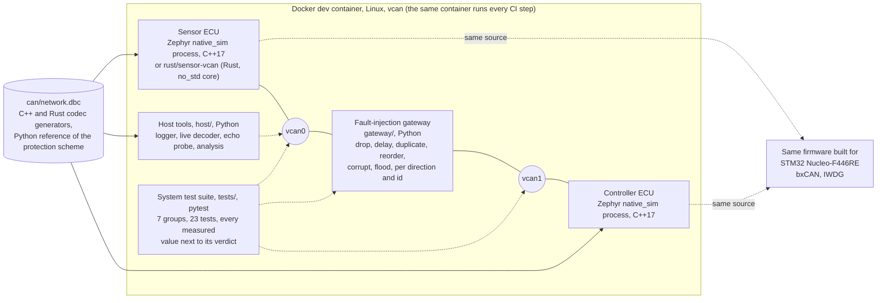
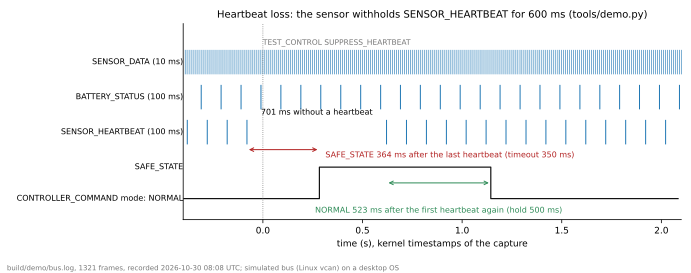
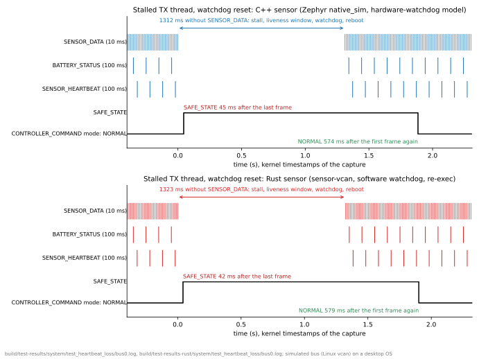
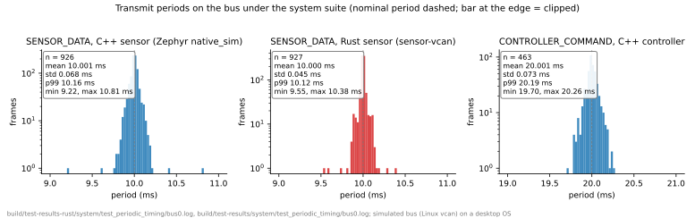
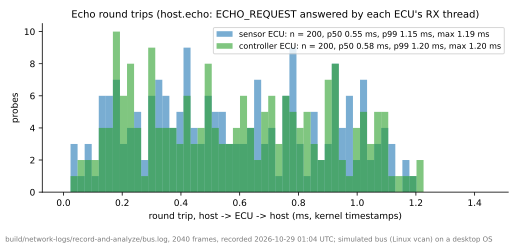

# can-ecu-sim

[](https://github.com/dcgursoy/can-ecu-sim/actions/workflows/ci.yml)

A simulated two-ECU CAN network on Zephyr RTOS, written in C++17, with a Python
fault-injection gateway, host tooling, an automated pytest suite, CI that also
builds the firmware for an STM32 Nucleo-F446RE, and the sensor ECU ported to
Rust (a `no_std` core under a SocketCAN adapter) as a cross-language conformance
check. Pure software: the ECUs are Zephyr `native_sim` processes, or the Rust
sensor, on a Linux virtual CAN bus (`vcan`) inside a Docker dev container, so
the whole network runs identically on any machine and in CI.

> Status: **complete, 8 of 8 phases.** [DESIGN.md](DESIGN.md) holds every
> design decision, the alternatives considered and the phase plan;
> [RESULTS.md](RESULTS.md) the raw data behind every number below, with the
> command that produced it; [docs/phase-logs/](docs/phase-logs/) the
> verification log of each phase, what failed first and how it was fixed.

## Architecture



Both ECUs run the same firmware; the role is a Kconfig choice. The sensor
publishes `SENSOR_DATA` every 10 ms, `BATTERY_STATUS` and a heartbeat every
100 ms; the controller answers with `CONTROLLER_COMMAND` every 20 ms and its
own heartbeat. Safety-relevant messages carry a 4-bit rolling counter and a
CRC-8 over the payload and the identifier. Each node watches its inputs with
per-message timeouts, drives a node state machine (BOOT, RUNNING, DEGRADED,
SAFE_STATE, FAULT), recovers its CAN controller from bus-off with an escalating
backoff, and feeds its watchdog only while every thread has checked in. The
gateway, the host tools and the test suite observe and disturb the network from
outside, through the same bus. The Rust sensor takes the C++ sensor's place
without any change to the controller, the gateway or the tests.

## Demo


Ten seconds of the real thing, recorded at a terminal in the dev container
(`tools/dev.sh tools/record-demo.sh`; the demo alone is `tools/dev.sh python3
tools/demo.py`): both ECUs boot on `vcan0`, the bus is decoded and every
protected frame's CRC verified against the Python reference, then the sensor
is told to withhold its heartbeat for 600 ms through the firmware's own test
hook, and the controller's reaction is read live off the bus: the SAFE_STATE
command after the 350 ms heartbeat timeout, the NORMAL command after the
500 ms recovery hold, then the controller's log and `ecu status`. The same
scenario is drawn from the same capture in the first figure below.

## What is here

- `can/network.dbc` the network: sensor data (10 ms), battery status (100 ms),
  controller command (20 ms), a heartbeat per ECU, an echo request/response
  pair and a test-only control message. Safety-relevant messages carry a 4-bit
  rolling counter and a CRC-8 that also covers the identifier
  ([DESIGN.md §10](DESIGN.md#10-phase-1-network-definition-protection-scheme-and-generated-codec)).
- `can/gen_codec.py` and `can/gen_rust.py` generate the C++17 and the Rust codec
  from the DBC; `can/e2e_ref.py` is the independent Python implementation of the
  protection scheme, `can/gen_test_vectors.py` draws the vectors both codecs are
  checked against from cantools and that reference; `can/crc_hd.py` is the
  measurement behind the polynomial choice.
- `firmware/lib/ecu_core/` the platform-independent ECU logic: message timeout
  monitor, protected-message acceptance policy, CAN error state machine with
  bus-off backoff and attempt limit, node state machine, thread liveness, and
  an ISO 11898-1 error counter model for the simulator. 77 GoogleTests cover
  both libraries at 100 % line coverage.
- `firmware/app/` the Zephyr application. One codebase, the ECU role chosen by
  Kconfig. Three threads (CAN receive, periodic transmit, supervisor) with
  justified priorities, a HAL for the CAN controller and the watchdog, a
  `TEST_CONTROL` handler behind a test-build Kconfig, an `ecu status` shell
  command, and a link-time guard that makes any dynamic allocation after
  start-up a fatal error. Builds for `native_sim` (SocketCAN) and for
  `nucleo_f446re` (bxCAN, IWDG) in both roles
  ([DESIGN.md §11](DESIGN.md#11-phase-2-the-firmware)).
- `gateway/` the fault-injection gateway between `vcan0` and `vcan1`: a Python
  relay that drops, delays and jitters, duplicates, reorders, corrupts and
  floods, per direction and per identifier, from a seeded random generator,
  reconfigurable at run time over a JSON control channel; its fault engine is
  pure and unit-tested with a fake clock. Firmware test hooks behind
  `CONFIG_APP_TEST_HOOKS` (on for `native_sim`, off for the Nucleo) suppress the
  heartbeat or any message, corrupt the CRC, skip or freeze the counter, drive
  the simulated CAN controller into error-passive or bus-off, and block a
  thread to prove the liveness monitor and the watchdog.
  [docs/fault-model.md](docs/fault-model.md) maps every simulated fault to the
  hardware failure it stands for ([DESIGN.md §12](DESIGN.md#12-phase-3-fault-injection)).
- `host/` the host tools on python-can and cantools, usable against any
  SocketCAN interface: a logger (candump-format log plus a decoded CSV), a live
  decoder (stream or table with per-message statistics), an echo probe timed
  from kernel timestamps, and an analysis of bus load at a chosen bit rate,
  period and jitter per message and echo round-trip percentiles
  ([DESIGN.md §13](DESIGN.md#13-phase-4-host-tooling)).
- `tests/` the system test suite (pytest): fixtures start both ECUs, the
  gateway and a `candump` per segment; seven groups, 23 tests (periodic
  timing, missing-message detection time, bad CRCs and stale or skipped
  counters, a flooded bus, error-passive and bus-off with recovery time,
  heartbeat loss into the safe state, and dropped, duplicated, delayed and
  reordered frames), every measured value logged next to its verdict, the
  expectations read from the firmware build's own `.config`. A host stall (a
  desktop process not scheduled) makes a test inconclusive and retried, never
  silently passed ([DESIGN.md §14](DESIGN.md#14-phase-5-the-automated-test-suite)).
- `tools/` wrappers to run anything inside the image, the firmware and Rust
  build scripts, the smoke test, the three network demos
  (`ecu_network.py`), the fifteen fault scenarios (`fault_scenarios.py`), the
  recorded run with the host tools (`record_and_analyze.py`), the system
  suite runner, the static analysis (clang-tidy over the application as both
  builds compile it, cppcheck over the libraries, every finding an error),
  the demo and its recorder (`demo.py`, `record_cast.py`, `record-demo.sh`),
  the figures (`plots.py`), and the Docker Desktop on Windows `vcan` fix
  (`tools/wsl2/`).
- `rust/` the sensor ECU a second time, in Rust: `sensor-core`, a `no_std`,
  allocation-free crate holding the generated codec, the protection scheme,
  the six state machines ported with their unit tests and the sensor
  application as a state machine without I/O (frames, ticks and the time in;
  frames, events and the watchdog decision out), cross-compiled for
  `thumbv7em-none-eabihf` in CI; and `sensor-vcan`, the thin `std` adapter on
  the `socketcan` crate with Zephyr's console format, so the unchanged test
  suite judges the pair
  ([DESIGN.md §16](DESIGN.md#16-phase-7-the-sensor-ecu-in-rust), with the
  main differences from the C++ version in §16.6).
- `.github/workflows/ci.yml` one job in the dev container: generated code
  against the DBC, Python and C++ unit tests with coverage, all four firmware
  images and their allocator check, static analysis, the Rust gate, then on
  `vcan` the smoke test, the network demos, the fault scenarios, the recorded
  run and both system-suite runs. Every suite writes a JUnit report; the
  artifacts carry the images, the reports, the logs and both runs' measured
  values, and a job summary puts them on the run page
  ([DESIGN.md §15](DESIGN.md#15-phase-6-continuous-integration)).

## Results

### Figures

Drawn by `tools/dev.sh python3 tools/plots.py` from the captures the runs
leave behind (kernel receive timestamps of the `vcan` interface); each
footer names its capture. All of it is a simulated bus on a desktop OS.



*The demo's scenario from its capture: `SENSOR_DATA` keeps flowing, the
heartbeat stops, the controller's command goes `SAFE_STATE` after the 350 ms
timeout and back to `NORMAL` 500 ms after the heartbeat's return.*



*The watchdog scenario of the system suite, C++ sensor above and Rust sensor
below: the transmit thread is blocked, the supervisor stops feeding the
watchdog once the thread is 300 ms stale, the watchdog resets the node after
another second, the rebooted sensor is accepted and the controller leaves its
safe state after the hold.*



*Transmit periods under the suite. The firmware's scheduler is exact; the
spread is the host's scheduling and, for the C++ sensor, the simulator's 1 ms
driver poll, which the Rust sensor does not have.*



*Echo round trips from `host.echo`: a request from the host, the ECU's receive
thread answering, the answer back at the host, timed from kernel timestamps.*

### Table

Every number is **measured on a simulated bus (Linux `vcan`) on a desktop OS,
not on real-time hardware**, and comes from the command in its row;
[RESULTS.md](RESULTS.md) has the full output of each run, and its section 0
lists for every row below the run, the commit and the CI run that reproduced
it. Two kinds of number need telling apart: the firmware's own clocks
(timeouts, recovery hold, watchdog) are exact and repeatable, while frame
jitter and round-trip latency measure the host's scheduler and the simulator's
1 ms driver poll and vary from run to run (a busier run is quoted in
parentheses).

| What | Measured | Command | Raw data |
|---|---|---|---|
| Bus load of the periodic traffic at 500 kbit/s | 4.00 % (DBC nominal 4.00 %; 4.86 % with worst-case stuffing); 5.51 % with the echo probes, busiest 100 ms window 7.4 % | `tools/dev.sh python3 tools/record_and_analyze.py --seed 2` | [RESULTS.md §1](RESULTS.md#1-phase-4-recording-of-the-plain-bus-network-with-the-host-tools) |
| SENSOR_DATA period, nominal 10 ms | mean 10.001 ms, std 0.10 ms, p99 10.25 ms, worst 10.53 ms (std 0.43, worst 11.43) | same | same |
| CONTROLLER_COMMAND period, nominal 20 ms | mean 20.001 ms, std 0.08 ms, p99 20.26 ms, worst 20.32 ms (std 0.47, worst 21.35) | same | same |
| Echo round trip, host → ECU → host | sensor p50 0.54 ms, p99 1.16 ms; controller p50 0.58 ms, p99 1.20 ms; 200 of 200 answered by each (p50 0.71 / 0.72, p99 2.2) | same | same |
| Gateway relay latency, no faults | median 0.13 ms, p99 0.27 ms (Python relay) | `tools/dev.sh python3 tools/fault_scenarios.py --scenarios baseline` | [RESULTS.md §4](RESULTS.md#4-earlier-phases), [phase3.md](docs/phase-logs/phase3.md) |
| Missing SENSOR_DATA detected (timeout 35 ms) | reaction on the bus 51.3 ms after the last delivered frame; back to normal 521.4 ms after the first frame again | `tools/dev.sh tools/run-system-tests.sh --coverage` | [RESULTS.md §2](RESULTS.md#2-phase-5-the-system-test-suite-every-measured-value) |
| Missing SENSOR_HEARTBEAT detected (timeout 350 ms) | reaction on the bus 371.0 ms after the last delivered frame; back to normal 511.2 ms after the first frame again | same | same |
| Missing BATTERY_STATUS detected (timeout 350 ms, DEGRADED) | reaction on the bus 421.5 ms after the last delivered frame; back to normal 20.9 ms after the first frame again | same | same |
| Missing CONTROLLER_COMMAND detected by the sensor (timeout 70 ms) | reaction on the bus 168.7 ms after the last delivered frame; back to normal 69.0 ms after the first frame again | same | same |
| Safe state when the sensor heartbeat is lost | SAFE_STATE 374.8 ms after the last heartbeat, NORMAL 513.9 ms after the first again; 42 commands over 840 ms with actuators off, brake hold, speed limit 0 | same | same |
| Safe state when the sensor process dies, recovery after its restart | SAFE_STATE 50.0 ms after the last SENSOR_DATA; restarted sensor's first frame 19.2 ms after the process start; NORMAL 507.5 ms after its first heartbeat; counters from zero accepted | same | same |
| Stalled transmit thread, watchdog reset | feed withheld 295.0 ms after the stall, watchdog reset 1301.6 ms after the last frame, first frame 11.6 ms after the reboot (1313.2 ms of silence in all); same process, controller safe state once | same | same |
| Error-passive entry and healing | visible in the heartbeat after 31.0 ms; 530.0 ms in error-passive (550 expected from TEC arithmetic); commands kept flowing at 50.0 /s | same | same |
| Bus-off recovery of the simulated controller | command silence 140.0 ms; bus-off to error-active 105.0 ms in the firmware log; SAFE_STATE entered, NORMAL again 499.9 ms after the first command | same | same |
| Repeated bus-off: backoff doubling, FAULT latch, `ecu reset` | silences 140.0 / 220.0 / 420.0 / 820.0 / 1620.2 ms, FAULT on the sixth with transmission stopped; after `ecu reset` first command 127.4 ms, NORMAL 627.4 ms | same | same |
| Flood of 2000 unknown frames/s on the controller's segment | 1999.9 frames/s achieved, 100.0 % counted, 0 dropped, queue high-water mark 5/32; CONTROLLER_COMMAND period p99 20.3 ms, max 20.7 ms; SENSOR_DATA still accepted at 99.9 /s | same | same |
| Flood sweep 1000 / 2000 / 4000 frames/s | achieved 999.9 / 1999.6 / 3999.4 frames/s, 100 % counted, nothing dropped, command period max 20.4 / 20.2 / 20.2 ms | same | same |
| Corrupted frames rejected by CRC | 22 rejected, 22 corrupted of 422; 0 timeouts, 0 safe-state entries | same | same |
| CRC fault published in the heartbeat flags | 61.9 ms after the first bad frame | same | same |
| Stale counter and duplicated frames rejected | 2 frozen, 2 stale on the bus, 2 rejected; 41 rejected, 41 duplicated of 362; flag after 72.1 ms | same | same |
| Random loss, 10 % both ways for 3 s, accounted for | 36 vs 36 + 0 (SENSOR_DATA); 4 vs 4 + 0 (SENSOR_HEARTBEAT); 16 vs 13 + 3 (CONTROLLER_COMMAND); dropped = lost by counter + frames inside timeout gaps | same | same |
| Latency 15 ± 5 ms and a constant 20 ms: no loss | SENSOR_DATA latency p1 10.4 ms, median 15.6 ms, p99 20.2 ms, no timeout; 20 ms step: largest gap 30.2 ms, no timeout | same | same |
| Reordered SENSOR_DATA rejected out of sequence | 31 swaps: 31 out-of-sequence rejections, 31 accepted with loss, 31 lost | same | same |
| SENSOR_DATA period under the suite (10 ms) | mean 10.001 ms, std 0.109 ms, p99 10.3 ms, min 9.4 ms, max 10.5 ms | same | same |
| Firmware clock against bus time | 1.000 firmware ms per host ms, largest deviation 0.84 ms over 3 s | same | same |
| Line coverage | firmware application under the suite 90.5 % of lines (939 of 1037; 90 % on the CI runner); library headers 100 % (937 of 937) under the 77 GoogleTests | `tools/dev.sh tools/run-system-tests.sh --coverage`, `tools/dev.sh tools/run-host-tests.sh` | [RESULTS.md §2.2](RESULTS.md#22-firmware-line-coverage-under-the-suite), [§2.3](RESULTS.md#23-unit-tests-of-the-firmware-libraries) |
| Static analysis | clang-tidy over 19 translation units of the application and the libraries, cppcheck over the 10 library-test units: no finding, every enabled check an error | `tools/dev.sh tools/static-analysis.sh` | [phase6.md §3](docs/phase-logs/phase6.md#3-static-analysis-clean) |
| The unchanged suite with the Rust sensor ECU in the sensor's place | 23 of 23 passed (86.5 s), every count the same as with the C++ sensor; controller SAFE_STATE 46.5 ms after the last SENSOR_DATA, NORMAL 516.4 ms after the first again; a lost CONTROLLER_COMMAND seen by the Rust sensor 143.1 ms after the last frame | `tools/dev.sh tools/run-system-tests.sh --results build/test-results-rust --sensor-exe rust/target/release/sensor-vcan` | [RESULTS.md §3](RESULTS.md#3-phase-7-the-same-suite-with-the-rust-sensor-ecu-in-the-sensors-place) |
| Rust sensor: SENSOR_DATA period (10 ms) and clock | mean 10.000 ms, std 0.050 ms, p99 10.1 ms, max 10.4 ms (C++ sensor: std 0.109, p99 10.3); 1.000 firmware ms per host ms, largest deviation 0.06 ms | same | same |
| Rust sensor: stalled transmit thread, software watchdog | feed withheld 305.1 ms after the stall, reset 1313.7 ms after the last frame, first frame 9.7 ms after the re-exec (1323.3 ms of silence in all); same pid, controller safe state once | same | same |
| Rust sensor: killed and restarted | controller SAFE_STATE 44.5 ms after its last SENSOR_DATA; first frame 15.5 ms after the process start; NORMAL 521.5 ms after its first heartbeat; counters from zero accepted | same | same |
| Rust gate | rustfmt and clippy (pedantic, every warning an error) clean; 34 unit tests, 6 conformance tests against the shared vectors; `sensor-core` built for `thumbv7em-none-eabihf` | `tools/dev.sh tools/build-rust.sh` | [phase7.md §2](docs/phase-logs/phase7.md#2-the-core-crate) |
| CI, the whole pipeline on a GitHub-hosted runner | 33 steps in 12 min 12 s: image build 74 s and push 56 s, four firmware images 103 s, static analysis 140 s, Rust gate 32 s, C++ suite with coverage 126 s, the suite again with the Rust sensor 85 s, 23 of 23 each | push to `main` (`.github/workflows/ci.yml`) | [phase7.md §5](docs/phase-logs/phase7.md#5-the-ci-run-of-this-phase), [RESULTS.md §2.4](RESULTS.md#24-the-same-suite-on-a-github-hosted-runner) |

## Quick start

Prerequisites: Docker Desktop on Windows (WSL2 backend) or Docker Engine on
Linux, plus Git (on Windows, Git for Windows, whose Git Bash the scripts use).
Nothing else is installed on the host. macOS: the image and the firmware build,
but the simulated bus needs the `vcan` driver in Docker Desktop's VM kernel,
which has not been verified there; treat the steps that use the bus as
Windows/Linux only.

1. **Windows only:** give the Docker VM a `vcan` driver. The first run builds the
   module (about five minutes); it is cached afterwards. The module is lost when
   the VM reboots (`wsl --shutdown`, a Windows reboot), and the wrappers in step 2
   reinstall it automatically in about ten seconds, so this step is only needed
   once by hand.

   ```powershell
   tools\wsl2\install-vcan-module.cmd
   ```

   (Git Bash: `tools/wsl2/install-vcan-module.sh`. The `.cmd` wrappers run
   PowerShell with `-ExecutionPolicy Bypass`, so they work on a stock Windows
   install where `.ps1` files are blocked.) Linux hosts instead run
   `sudo modprobe vcan`. Details in
   [DESIGN.md §6](DESIGN.md#6-development-environment-docker-capabilities-and-vcan-on-wsl2).

2. **Build the dev image** (about ten minutes the first time):

   ```bash
   tools/dev.sh --build
   ```

   PowerShell or cmd: `tools\dev.cmd -Build`. VS Code users can instead open the
   folder and choose "Reopen in Container".

3. **Build the firmware**, one image per board and role (Windows:
   `tools\dev.cmd` with the same arguments):

   ```bash
   tools/dev.sh tools/build-ecu.sh native_sim sensor
   ```

   ```bash
   tools/dev.sh tools/build-ecu.sh native_sim controller
   ```

   ```bash
   tools/dev.sh tools/build-ecu.sh nucleo_f446re controller
   ```

4. **Run the network on the virtual bus.** Both ECUs for three seconds, every
   frame verified against the DBC and the Python reference, both shells queried:

   ```bash
   tools/dev.sh python3 tools/ecu_network.py run
   ```

   Kill the sensor and bring it back, and measure how fast the controller
   enters and leaves its safe state:

   ```bash
   tools/dev.sh python3 tools/ecu_network.py safe-state
   ```

   Drive the controller's CAN controller into error-passive and bus-off through
   the test hook and watch the backoff, the recovery and what the bus saw:

   ```bash
   tools/dev.sh python3 tools/ecu_network.py bus-off
   ```

   Put the fault-injection gateway between the ECUs (sensor on `vcan0`,
   controller on `vcan1`) and run the fifteen fault scenarios, from a 15 ms
   jittering relay to a flooded segment and a stalled firmware thread that
   the watchdog resets (about 90 s; `--list` names them, `--scenarios a,b`
   picks some, `--seed` changes the random faults):

   ```bash
   tools/dev.sh python3 tools/fault_scenarios.py
   ```

   The gateway also runs on its own, e.g. `python3 -m gateway.gateway --both
   '{"drop": 0.1, "delay_ms": 5}'` inside the container, and prints its
   counters when stopped.

5. **Watch, record and analyse the bus with the host tools.** The one-shot
   version starts both ECUs, records eight seconds with the logger while the
   live decoder watches, sends 200 echo probes to both ECUs and prints the
   analysis of the recording: bus load, period and jitter per message, echo
   round-trip percentiles (logs in `build/network-logs/record-and-analyze/`):

   ```bash
   tools/dev.sh python3 tools/record_and_analyze.py
   ```

   The tools also run one at a time against any SocketCAN interface. Inside
   one container (`tools/dev.sh` with no arguments opens a shell; start the
   ECUs as described below), for example:

   ```bash
   python3 -m host.decoder --iface vcan0 --mode table
   ```

   ```bash
   python3 -m host.logger --iface vcan0 --duration 10 --out build/host-logs
   ```

   ```bash
   python3 -m host.echo --iface vcan0 --count 200
   ```

   ```bash
   python3 -m host.analysis build/host-logs/bus.log
   ```

   `host.decoder --mode stream` prints every frame decoded, and `--file
   bus.log` decodes a recording instead of an interface.

6. **Run the unit tests:** the Python reference implementation, the gateway's
   fault engine and the host tools, then the C++ libraries with coverage
   (report in `build/host-tests/coverage.txt`):

   ```bash
   tools/dev.sh python3 -m pytest -q can/ gateway/ host/
   ```

   ```bash
   tools/dev.sh tools/run-host-tests.sh
   ```

   After editing `can/network.dbc`, regenerate the codecs and the test vectors
   with `tools/dev.sh tools/gen-all.sh`; CI fails if the committed copies are
   stale.

7. **Run the static analysis** (clang-tidy and cppcheck over the firmware, a
   few minutes; needs the `native_sim` builds and the host unit-test build,
   which it makes if missing; reports in `build/static-analysis/`):

   ```bash
   tools/dev.sh tools/static-analysis.sh
   ```

8. **Run the system test suite** (about 90 s; the seven groups against
   both ECUs through the gateway, every measured value printed next to its
   verdict, results in `build/test-results/`):

   ```bash
   tools/dev.sh python3 -m pytest tests -v
   ```

   `-k bus_off` picks a group, `--seed` changes the gateway's random faults.
   The same suite on gcov-instrumented firmware builds, with the JUnit report
   and the firmware's line coverage under the suite in
   `build/test-results/firmware-coverage.txt`:

   ```bash
   tools/dev.sh tools/run-system-tests.sh --coverage
   ```

9. **Build and test the Rust sensor ECU, then run the unchanged suite with it
   in the sensor's place** (rustfmt, clippy, the unit and conformance tests,
   the release build and the `thumbv7em-none-eabihf` cross-compile, about a
   minute; then the 23 tests, about 90 s, results in `build/test-results-rust/`):

   ```bash
   tools/dev.sh tools/build-rust.sh
   ```

   ```bash
   tools/dev.sh tools/run-system-tests.sh --results build/test-results-rust --sensor-exe rust/target/release/sensor-vcan
   ```

10. **Run the demo, record it, draw the figures.** The demo alone narrates the
    heartbeat-loss scenario at the terminal in about ten seconds; the recorder
    runs it under a pseudo-terminal, writes an asciicast and renders the GIF
    with `agg` (`--publish` replaces `docs/figures/demo.gif`); the plot script
    draws the four figures of the README from the captures of steps 5, 8, 9
    and the demo (`--publish`-free: it writes `docs/figures/*.svg` directly):

    ```bash
    tools/dev.sh python3 tools/demo.py
    ```

    ```bash
    tools/dev.sh tools/record-demo.sh --publish
    ```

    ```bash
    tools/dev.sh python3 tools/plots.py
    ```

To poke around interactively, `tools/dev.sh` with no arguments opens a shell in
the container; inside it `tools/vcan-up.sh` creates `vcan0` and `vcan1`, then
`build/native_sim_sensor/zephyr/zephyr.exe --can-if=vcan0 &` (or the Rust
sensor, `rust/target/release/sensor-vcan --can-if=vcan0 &`) and
`build/native_sim_controller/zephyr/zephyr.exe --can-if=vcan0` start the ECUs
(type `ecu status` at the prompt), and `candump vcan0` shows the traffic. Each
`tools/dev.sh <cmd>` call starts a fresh container with its own network
namespace, so interfaces created by one call are gone in the next: do
multi-process work inside one interactive shell or in the VS Code dev
container, whose `postStartCommand` runs `vcan-up.sh`.

## Layout

```
.devcontainer/   toolchain image            firmware/app/        Zephyr application (C++17)
.github/         CI                         firmware/lib/        protocol codec + ECU logic, host-tested
can/             network.dbc, generators,   gateway/             fault-injection gateway
                 Python reference           host/                logger, decoder, echo probe, analysis
tools/           wrappers, vcan, demos      tests/               system test suite (pytest, seven groups)
docs/            fault model, phase logs,   rust/                Rust sensor ECU: no_std core, vcan adapter
                 figures, toolchain versions
DESIGN.md        every decision and why     RESULTS.md           raw data behind the numbers above
```

## Documentation

- [DESIGN.md](DESIGN.md): the decisions, phase by phase, with the alternatives
  that lost and why, written to be repeated in an interview without the code
  at hand; the phase plan and exit criteria are in
  [§9](DESIGN.md#9-phase-plan-and-exit-criteria), the lessons of the whole
  project in [§17](DESIGN.md#17-phase-8-documentation-traceability-and-what-the-project-taught).
- [RESULTS.md](RESULTS.md): the raw data, run by run, with the command, the
  commit and the CI run that reproduced it; section 0 maps every row of the
  table above to its source.
- [docs/fault-model.md](docs/fault-model.md): what each simulated fault stands
  for on a real bus, and what the simulation does not reproduce.
- [docs/phase-logs/](docs/phase-logs/): one verification log per phase, with
  the first failing attempts, the measurements and the review findings.

## License

MIT, see [LICENSE](LICENSE).
